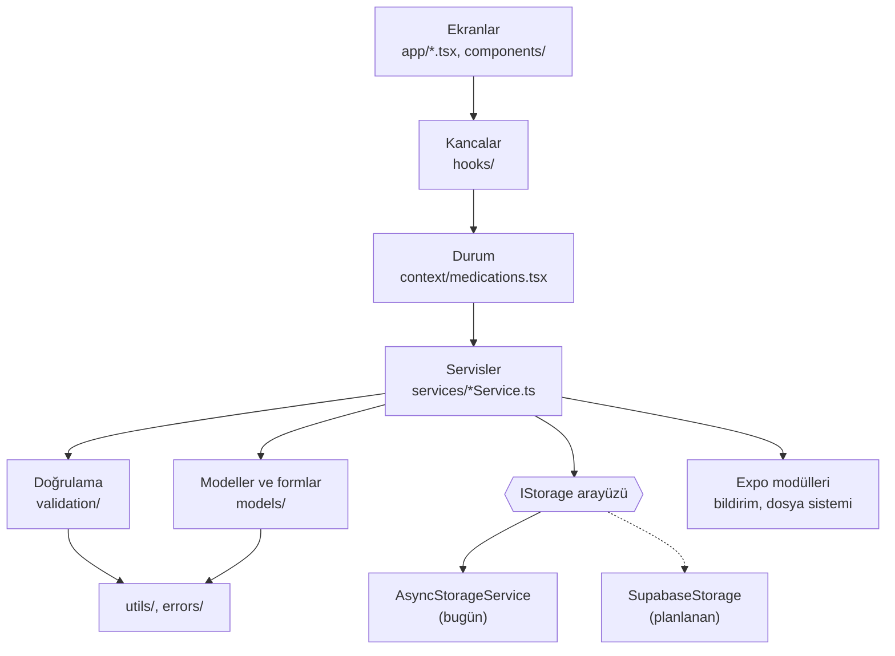
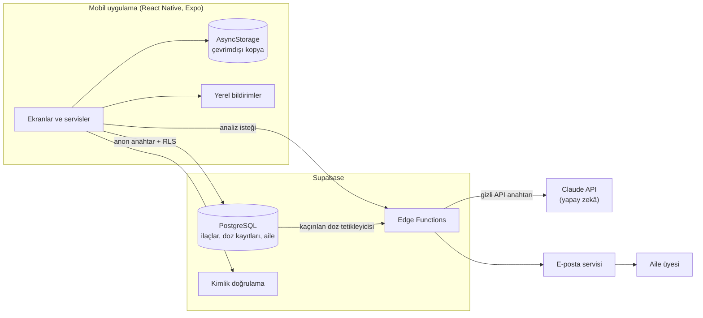
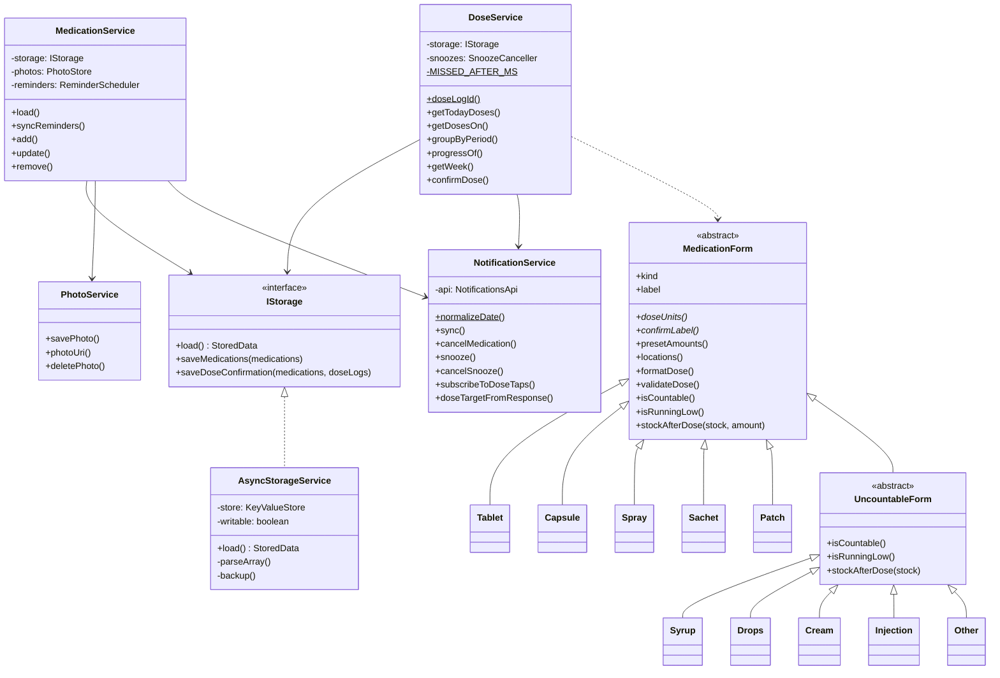

# Modüler Yapı

Bu belge, projenin modülerliğin dört seviyesine (fonksiyon, sınıf, paket/dosya, sistem) ve nesne yönelimli programlama (OOP) ilkelerine göre yeniden düzenlenmesini anlatır. Refactor `refactor/moduler-yapi` dalında yapıldı; başlangıç noktası `v0.1-sprint1` etiketidir.

## Mevcut Durum

Refactor öncesi (`v0.1-sprint1`) kod `app/src/` altında yaklaşık 1300 satırdı.

### Dosyalar ve görevleri

| Dosya                     | Görevi                                                                                   |
| ------------------------- | ---------------------------------------------------------------------------------------- |
| `types.ts`                | `Medication` ve `DoseLog` tipleri                                                        |
| `lib/storage.ts`          | AsyncStorage okuma/yazma fonksiyonları (`medications`, `doseLogs` anahtarları)           |
| `lib/doses.ts`            | `Dose` tipi, tarih biçimleme, doz kimliği, bugünkü dozların durum hesabı                 |
| `lib/notifications.ts`    | Bildirim izni, kanal, günlük planlama, eşitleme, test bildirimi, iOS/Android tarih farkı |
| `lib/photos.ts`           | Fotoğrafı kalıcı klasöre kopyalama ve dosya adından yol çözme                            |
| `context/medications.tsx` | Veriyi yükleme, ilaç ekleme, doz onaylama, stok düşme, hata mesajları, durum             |
| `app/_layout.tsx`         | Kök Stack, açılış ekranı, bildirime dokununca ALDIM sayfasına gitme                      |
| `app/index.tsx`           | Bugünkü dozlar, izin uyarısı, saat yenileme, test bildirimi                              |
| `app/ilac-ekle.tsx`       | İlaç ekleme formu, fotoğraf seçme, saat ekleme, doğrulama, kaydetme (289 satır)          |
| `app/aldim/[id].tsx`      | Tam ekran ALDIM onayı                                                                    |
| `components/*`            | `BigButton`, `DoseCard`, `TimeStepper`                                                   |
| `constants/theme.ts`      | Yüksek kontrastlı tema                                                                   |

### Dört seviyeye göre eksikler

- **Fonksiyon:** `ilac-ekle.tsx` içindeki `validate` ve `save` hem doğrulama hem kaydırma hem kaydetme işini yapıyor. `context` içindeki `addMedication` kimlik üretme, fotoğraf kopyalama, yazma ve bildirim planlamayı tek fonksiyonda topluyor.
- **Sınıf:** Hiç sınıf yok; tüm iş mantığı serbest fonksiyonlarda ve React context'inde. Bağımlılıklar (AsyncStorage, expo-notifications) doğrudan içe aktarıldığı için sahte nesneyle test edilemiyor.
- **Paket/dosya:** `lib/` klasörü depolama, iş kuralı ve platform kodunu karıştırıyor. Doğrulama ekran dosyasının içinde. Model tipleri ile `Dose` tipi farklı yerlerde. Hook klasörü yok.
- **Sistem:** Uygulama tek parça; Supabase, sunucu fonksiyonları ve yapay zekâ için bir arayüz (soyutlama) yok. Ortam değişkeni yapısı yok.

### OOP'ye göre eksikler

- **Kapsülleme:** Depolama anahtarları ve 30 dakikalık kaçırma süresi modül değişkeni; korunan bir nesne içinde değil.
- **Soyutlama:** Depolama için arayüz yok; Supabase'e geçişte her çağıran dosya değişmek zorunda.
- **Kalıtım / çok biçimlilik:** İlaç formu kavramı yok; ALDIM metni sabit yazılmış.
- **Bağımlılık enjeksiyonu:** Yok.

### Savunmacı programlamaya göre eksikler

- `JSON.parse` sonucu tip kontrolü olmadan `Medication[]` sayılıyor; bozuk veri çökmeye yol açabilir.
- Açılışta veri okunamazsa sadece konsola yazılıyor, kullanıcı boş liste görüyor. Ardından yapılan ilk kayıt bozuk veriyi ezebiliyor.
- Kayıtlı veride sürüm numarası ve göç yapısı yok.
- Ekranlar çökerse kullanıcıya bir şey gösterilmiyor (ErrorBoundary yok).
- Kod kalitesi araçları (ESLint, Prettier), test ve CI yok.

## Yeni Yapı

### Klasör ağacı

```text
app/src/
├── app/                      # Ekranlar (Expo Router). İnce: yalnızca kanca çağırır
│   ├── _layout.tsx           # Kök Stack, yazı tipi, ErrorBoundary, bildirim dokunuşu
│   ├── (tabs)/               # Alt menü: index (Bugün), ilaclarim, gecmis
│   ├── ilac-ekle.tsx         # Sihirbaz (yeni ilaç)
│   ├── ilac-duzenle/[id].tsx # Aynı sihirbaz, dolu
│   ├── aldim/[id].tsx        # Tam ekran ilaç zamanı ve başarı
│   └── ayarlar.tsx
├── components/               # Görsel bileşenler
│   ├── wizard/               # WizardStepLayout ve dokuz adım
│   ├── form/                 # TextField, FieldError
│   ├── app-text, icon, card, pill, banner, section-header, screen-header
│   ├── primary-button, secondary-button (ortak gövde: button-base), icon-button
│   ├── option-card, chip-group, number-stepper, time-stepper
│   ├── status-chip, progress-ring, medication-photo
│   └── dose-card, dose-prompt, dose-done, medication-card, week-days, settings-row, ...
├── hooks/                    # useMedications, useTodayDoses, useMedicationWizard, ...
├── context/medications.tsx   # Sadece React durumu; iş kuralı yok
├── services/                 # İş mantığı sınıfları
│   ├── StorageService.ts     # IStorage arayüzü + AsyncStorageService
│   ├── migrations.ts         # Kayıtlı veri sürüm göçleri
│   ├── MedicationService.ts, DoseService.ts, DoseCalculator.ts, HistoryService.ts
│   ├── NotificationService.ts, ReminderPlanner.ts, PhotoService.ts
│   ├── AuthService.ts, ProfileRepository.ts, ProfileCache.ts, auth-errors.ts, ports.ts
│   └── index.ts              # Bağımlılıkların kurulduğu tek yer
├── models/                   # Tipler ve form sınıfları
│   ├── medication.ts, schedule.ts (plan), dose-log.ts, dose.ts
│   └── forms/                # MedicationForm (soyut) ve on form sınıfı
├── validation/               # medication-input, wizard-steps (girdi), stored-records (kayıt)
├── errors/                   # AppError, ValidationError, StorageError, NotificationError
├── utils/                    # Saf fonksiyonlar: date, time, schedule, json, id, logger
├── constants/theme.ts        # Yüksek kontrastlı tema
├── config.ts                 # Ortam değişkenleri
└── test-utils/fakes.ts       # Testler için sahte depolama
```

Testler ilgili klasörün `__tests__/` alt klasöründedir (örn. `services/__tests__/DoseService.test.ts`).

### Dört seviye

| Seviye               | Projedeki karşılığı                                                                       | Örnekler                                                                                                                                                                                                                                                                                 |
| -------------------- | ----------------------------------------------------------------------------------------- | ---------------------------------------------------------------------------------------------------------------------------------------------------------------------------------------------------------------------------------------------------------------------------------------- |
| **1. Fonksiyon**     | Her fonksiyon tek iş yapar; saf fonksiyonlar yan etkisizdir ve tek başına test edilir.    | `formatDate`, `atTime` (`utils/date.ts`); `isValidTime`, `formatTime` (`utils/time.ts`); `safeJsonParse` (`utils/json.ts`); `isScheduledOn`, `nextOccurrence` (`utils/schedule.ts`); `validateMedicationDraft`, `changesOf` (`validation/medication-input.ts`)                           |
| **2. Sınıf**         | Birbiriyle ilgili veri ve davranış bir sınıfta toplanır; iç durum `private`.              | `DoseCalculator` (günün dozları ve durumları), `HistoryService` (Geçmiş haftası), `DoseService` (doz onayı), `MedicationService` (ekle/sil/güncelle/listele), `NotificationService`, `PhotoService`, `AsyncStorageService`, `Logger`, `MedicationForm` ve alt sınıfları, `ErrorBoundary` |
| **3. Paket / dosya** | Klasörler katmanlara karşılık gelir; her klasör `index.ts` ile dışa açtığı şeyi belirler. | `models/`, `services/`, `validation/`, `errors/`, `utils/`, `hooks/`, `components/`, `app/`                                                                                                                                                                                              |
| **4. Sistem**        | Uygulama, sunucu ve dış servisler ayrı bileşenlerdir; aralarında arayüz vardır.           | Mobil uygulama ↔ `IStorage` ↔ Supabase; Edge Functions ↔ Claude API; e-posta servisi (aşağıda)                                                                                                                                                                                           |

Ekran dosyaları incedir: `ilac-ekle.tsx` 5 satırdır; sihirbazın durumu `useMedicationWizard`, kuralları `validation/`, görünümü `components/wizard/` içindedir.

### Katmanlar

Bağımlılık yönü tek yönlüdür: üst katman alttakini bilir, alttaki üsttekini bilmez.

**Kural: Ekranlar servislere yalnızca kancalar üzerinden erişir.** `src/app/` ve `src/components/` altındaki dosyalar `@/services`'i, `expo-notifications`'ı veya depolamayı doğrudan import etmez. Servis çağrısı gereken her yer için `src/hooks/` altında bir kanca yazılır:

| Kanca                       | Arkasındaki servis                                                           | Kullanan                                  |
| --------------------------- | ---------------------------------------------------------------------------- | ----------------------------------------- |
| `useMedications`            | context → `MedicationService`, `DoseService`                                 | Tüm ekranlar                              |
| `useTodayDoses`             | `DoseCalculator.getTodayDoses`, `groupByPeriod`, `progressOf`, `nextPending` | Bugün                                     |
| `useHistoryWeek`            | `HistoryService.getWeek`                                                     | Geçmiş                                    |
| `useDose`                   | Doz onayı (`useConfirmDose`), sıradaki doz                                   | `aldim/[id].tsx`                          |
| `useConfirmDose`            | context → `DoseService.confirmDose`; çift dokunuş koruması, titreşim         | `useDose`, `useSimpleHome`                |
| `useSimpleHome`             | `DoseCalculator.focusDose`, `progressOf`                                     | Sade ana ekran                            |
| `useMedicationList`         | context → `MedicationService.update/remove`                                  | İlaçlarım                                 |
| `useSnooze`                 | `NotificationService.snooze`                                                 | `aldim/[id].tsx`                          |
| `useMedicationWizard`       | context → `MedicationService.add/update`                                     | Sihirbaz                                  |
| `useMedicationPhoto`        | `PhotoService.photoUri`                                                      | `MedicationPhoto`, `DosePrompt`, sihirbaz |
| `useReminderSync`           | `MedicationService.syncReminders`                                            | `_layout.tsx`                             |
| `useTestNotification`       | `NotificationService.scheduleTest`                                           | Ayarlar (`__DEV__`)                       |
| `useNotificationPermission` | `NotificationService` izin metotları                                         | Bugün, Ayarlar                            |
| `useDoseNotificationTaps`   | `NotificationService.subscribeToDoseTaps`                                    | `_layout.tsx`                             |

Gerekçe: Ekranlar yalnızca görünümle ilgilenir. Bir servis değişirse (örneğin Supabase'e geçişte) sadece kanca güncellenir. Bildirim kütüphanesi değişirse yalnızca `NotificationService` etkilenir. Bildirimin genel ayarı (`notificationService.configure()`) da ekranda değil, bağımlılıkların kurulduğu `services/index.ts`'de yapılır.



### Planlanan sistem mimarisi



- **Mobil uygulama:** Bugünkü hali. Veri `IStorage` üzerinden okunur; Supabase'e geçişte `services/index.ts` içindeki tek satır değişir, ekranlar etkilenmez.
- **Supabase:** Veritabanı, kimlik doğrulama ve satır güvenliği (RLS). Uygulama yalnızca herkese açık anon anahtarı bilir (`config.ts`).
- **Edge Functions:** Claude API anahtarı yalnızca burada sunucu sırrı olarak tutulur; uygulamaya hiç girmez.
- **Claude API:** Kullanım alışkanlıklarının analizi ve yardım metinleri.
- **E-posta bildirimi:** Kaçırılan dozda aile üyesine e-posta (Push yetkisi ücretsiz Apple hesabında yok; bkz. `kararlar.md` 1. karar).

## OOP Uygulaması

### Kapsülleme

Servislerin bağımlılıkları ve sabitleri `private` alanlardadır; dışarıya yalnızca gereken metotlar açılır.

```ts
export class DoseService {
  private static readonly MISSED_AFTER_MS = 30 * 60 * 1000;
  private readonly storage: IStorage;
  private readonly now: () => Date;
  // public: doseLogId, getTodayDoses, getDosesOn, groupByPeriod, progressOf, getWeek, confirmDose
  // private: dosesOf, planPeriods, statusOf, summaryOf, withStockAfterDose
}
```

- `AsyncStorageService` depolama anahtarlarını dışarıya açmaz; `private writable` bayrağı veri okunamadığında yazmayı kapatır. Dışarıdan bu bayrak değiştirilemez.
- `NotificationService` kanal kimliğini ve test önekini `private static` tutar.
- `Logger` kayıt hedeflerini `private readonly sinks` dizisinde tutar; yalnızca `addSink` ile eklenebilir.

### Soyutlama

- `IStorage` (`services/StorageService.ts`): `load`, `saveMedications`, `saveDoseConfirmation`. Servisler ve context yalnızca bu arayüzü bilir; `AsyncStorageService` bugünkü uygulamasıdır, Supabase sınıfı aynı arayüzü uygulayacak.
- `KeyValueStore`: AsyncStorage'ın kullandığımız üç metodu. Testte `MemoryKeyValueStore` verilir.
- `PhotoStore`, `ReminderScheduler`, `SnoozeCanceller`, `NotificationsApi`, `LogSink`: servislerin dış dünyadan beklediği en küçük arayüzler.
- Ekranlar servis sınıfını hiç bilmez; yalnızca kancaları (`useMedications`, `useTodayDoses`, `useDose` ...) çağırır. Bkz. Katmanlar bölümündeki kural.

### Kalıtım

`MedicationForm` soyut sınıftır. Sayılan formlar (`Tablet`, `Capsule`, `Spray`, `Sachet`, `Patch`) doğrudan ondan türer. Sayılamayan formlar (`Syrup`, `Drops`, `Cream`, `Injection`, `Other`) araya giren `UncountableForm` sınıfından türer ve stok kuralını oradan devralır. Kayıtlı ilaçlarda `form` alanı yoksa (eski kayıtlar) `Tablet` sayılır.

### Çok biçimlilik

Ekran formun türüne bakmaz, `if/switch` yoktur:

```tsx
const form = getMedicationForm(medication.form);
<PrimaryButton label={form.confirmLabel()} />; // Tablet: Aldım, Şurup: İçtim, Damla: Damlattım
```

`DoseService` de stoğu aynı şekilde düşürür: `getMedicationForm(medication.form).stockAfterDose(stock, amount)`. Tablet doz kadar (yarım olabilir) azaltır, şurup azaltmaz. Sihirbazın dozaj ve stok adımları da formun `doseUnits()`, `presetAmounts()`, `locations()`, `isCountable()` metotlarından kurulur; yeni form eklemek ekranı değiştirmez. Türden sınıfa geçiş de `switch` yerine bir tabloyla (`FORMS` kaydı, `models/forms/index.ts`) yapılır.

### Bağımlılık enjeksiyonu

Servisler bağımlılıklarını constructor ile alır. Gerçek nesneler tek bir yerde (`services/index.ts`) kurulur:

```ts
export const storage: IStorage = new AsyncStorageService(AsyncStorage);
export const doseService = new DoseService(storage, notificationService);
export const medicationService = new MedicationService(
  storage,
  photoService,
  notificationService,
);
```

Testte sahteleri verilir:

```ts
const service = new DoseService(
  new FakeStorage(),
  sahteErteleme,
  () => new Date(2026, 10, 16, 9, 0),
);
```

`MedicationsProvider` da isteğe bağlı `services` özelliği alır.

### Sınıf diyagramı



## Savunmacı Programlama

### Girdi doğrulama (`validation/medication-input.ts`)

- Ad boş olamaz; form ve aç/tok seçilmelidir. Fotoğraf isteğe bağlıdır.
- Doz, formun kendi aralığı ve adımıyla denetlenir (`MedicationForm.validateDose`).
- Belirli günlerde en az bir gün, süreli kullanımda 1-90 gün.
- En az bir saat; her saat `HH:mm` biçiminde (`isValidTime`).
- Stok 0-999 arası, 0,5 adımlı (yarım tablet).
- Sihirbaz her adımda `stepError` ile yalnızca o adımın alanlarını denetler. `MedicationService.add` ve `update` aynı kuralları `assertValidNewMedication` ve `assertValidChanges` ile ikinci kez uygular. Böylece ekran dışından gelen veri de denetlenir.

### Kayıtlı veri (`validation/stored-records.ts`, `StorageService`)

- `JSON.parse` hiç doğrudan çağrılmaz; `safeJsonParse` hata fırlatmaz.
- Okunan her kayıt tip kontrolünden geçer. Kimliği veya adı olmayan kayıt atlanır. Eksik alanlar varsayılanla doldurulur: stok 0, saat listesi boş, form tablet.
- Bozuk veri **silinmez ve ezilmez**: ham hali `medications.yedek-<zaman>` gibi ayrı bir anahtara kopyalanır, ana ekranda Türkçe uyarı gösterilir.
- Depolama hiç okunamazsa sessizce boş liste gösterilmez. Uyarı çıkar ve yazma kapatılır, böylece bilinmeyen veri ezilmez.
- Stok hiçbir zaman negatife düşmez: `MedicationForm.stockAfterDose`, `sanitizeStock`.

### Hata sınıfları (`errors/`)

`AppError` teknik `message` ile kullanıcıya gösterilecek Türkçe `userMessage`'ı ayırır. Alt sınıfları: `ValidationError` (alan hatalarını taşır), `StorageError`, `NotificationError`. Ekranlar `userMessageOf(error, varsayılan)` ile mesaj gösterir. Konsola doğrudan yazılmaz; tüm kayıtlar `utils/logger.ts` üzerinden geçer. İleride buna uzak bir hedef eklenebilir.

### ErrorBoundary (`components/error-boundary.tsx`)

Kök düzeyde tüm ekranları sarar. Bir ekran çizilirken hata çıkarsa "Bir sorun oluştu" mesajı ve "Yeniden dene" butonu gösterilir. Açılış ekranı açık kalmışsa kapatılır. React'te hata sınırı yalnızca sınıf bileşeniyle yazılabilir.

### Veri göçü (`services/migrations.ts`)

- Yeni `schemaVersion` anahtarı eklendi. Anahtar yoksa veri v0 (`v0.1-sprint1` biçimi) sayılır.
- **v1:** `form` alanı olmayan ilaçlara `form: "tablet"` eklenir. Diğer alanlar ve `medications` / `doseLogs` anahtarları aynen kalır.
- **v2:** Miktar, birim, bölge, aç/tok, sıklık, süre, stok sınırı ve eski planlar eklenir. Önce varsayılanlar, sonra kayıt yayılır; kayıtta olan hiçbir alanın üzerine yazılmaz.
- Göç sonucu diske yazılır. Bozuk veri bulunduysa yazılmaz; yedeklenen ham veri olduğu gibi kalır.
- Daha yeni bir sürümden gelen veriye (sürüm > güncel) göç uygulanmaz.
- Eski uygulama (`v0.1-sprint1`) bilmediği `form` alanını yok sayar, yani geri dönüş de güvenlidir.

## Testler

`npm test` Jest'i kapsam raporuyla çalıştırır (`app/coverage/`). Kapsam ölçümü mantık katmanlarını kapsar: `services`, `models`, `validation`, `utils`, `errors`. Ekranlar, bileşenler ve kancalar ölçüme dahil değildir; bunlar telefonda elle test edilir. Bildirim, kamera ve titreşim zaten yalnızca gerçek cihazda doğrulanabilir. `PhotoService` dosya sistemine bağlı olduğu için birim testi yoktur.

## Temizlenecek paketler

Aşağıdaki paketler uygulama kodunda doğrudan kullanılmıyor. Bu refactor'da **silinmedi**; kaldırmadan önce `npx expo-doctor` ve telefonda deneme yapılmalı.

| Paket                           | Kodda kullanım                           | Not                                                                                                                                                                  |
| ------------------------------- | ---------------------------------------- | -------------------------------------------------------------------------------------------------------------------------------------------------------------------- |
| `expo-web-browser`              | Yok                                      | Hiçbir paket buna bağlı değil. **Güvenle kaldırılabilir.**                                                                                                           |
| `expo-device`                   | Yok                                      | Hiçbir paket buna bağlı değil. **Güvenle kaldırılabilir.**                                                                                                           |
| `expo-linking`                  | Yok (`Linking` react-native'den geliyor) | **Dolaylı:** `expo-router`'ın zorunlu peer bağımlılığı. Kalmalı.                                                                                                     |
| `expo-glass-effect`             | Yok                                      | **Dolaylı:** `expo-router`'ın doğrudan bağımlılığı; package.json'dan silinse de kurulur.                                                                             |
| `expo-symbols`                  | `components/icon.tsx`                    | 1. turdan beri kullanılıyor. Kalmalı.                                                                                                                                |
| `@expo/ui`                      | Yok                                      | **Dolaylı:** `expo-router`'ın isteğe bağlı peer bağımlılığı. Kaldırılabilir.                                                                                         |
| `react-native-reanimated`       | Yok                                      | **Dolaylı:** `expo-router` (drawer) isteğe bağlı peer. Animasyon eklenirse gerekir.                                                                                  |
| `react-native-worklets`         | Yok                                      | **Dolaylı:** `react-native-reanimated`'ın zorunlu peer bağımlılığı. Reanimated ile birlikte gider.                                                                   |
| `react-native-gesture-handler`  | Yok                                      | **Dolaylı:** `expo-router` (drawer) isteğe bağlı peer.                                                                                                               |
| `react-native-web`, `react-dom` | Yok                                      | **Dolaylı:** `expo`, `expo-router`, `expo-image` web desteği için isteğe bağlı peer. Web hedef dışı; kaldırılabilir ama `app.json`'daki `web` ayarı da temizlenmeli. |
