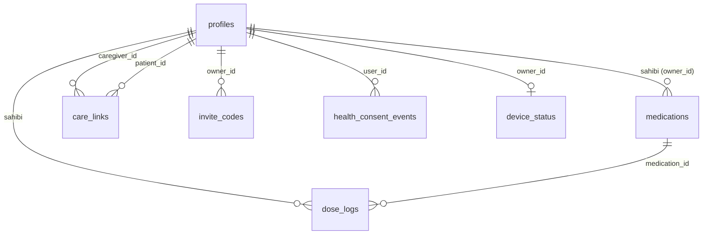
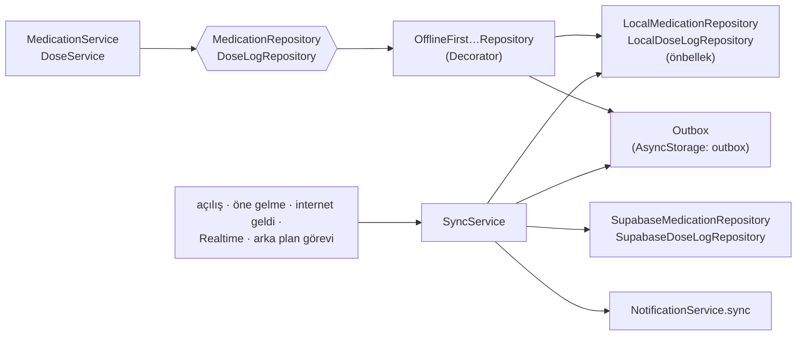

# 2. Tur, 2. Parça Planı: İlaçların Buluta Taşınması, Davet Kodu ve Aile Paneli

**Tarih:** 26 Kasım 2026 · **Dal:** `feature/tur2-aile` (`main`'den, `v0.4-hesap-kalite` etiketinden sonra) · **Durum:** Onaylandı (26 Kasım 2026; cevaplar i bölümünde)

Bu belge kod yazılmadan önceki plandır. Adımlar aşağıdaki sırayla, TDD ile ve ayrı commit grupları halinde uygulanır. Kararlar `docs/kararlar.md`'ye ADR olarak geçer (ADR-021…026, bkz. bölüm j). SQL'in kendisi `supabase/migrations/20261126120000…120500` dosyalarındadır.

**Temel ilke:** Yaşlının telefonu internetsiz de tam çalışmaya devam eder. Hatırlatmalar yereldir (ADR-001), sunucu yalnızca kopyalama ve aileyle paylaşma içindir. Bugünkü katmanlar korunur. Repository arayüzleri (ADR-020) bu parçanın girişidir; servisler ve ekranlar olabildiğince değişmez.

---

## a) Veritabanı tabloları

### Adlandırma

Yeni tablo ve sütun adlarının hepsi İngilizce `snake_case`'tir ve ilaç modelindeki alanların karşılığıdır (`meal_timing` ↔ `mealTiming`). "Telefona ulaştı" bilgisi de `delivered_at` adını alır. Çeviri tek bir eşleme fonksiyonuyla yapılır, yanlış ad derlemede yakalanır (`npm run tipler`). `profiles`'taki eski Türkçe sütunlar (`ad`, `rol`) değişmez; adlarını değiştirmek giriş yapmış kullanıcıları bozardı.

### `medications`

| Sütun                              | Tip             | Kural                                                                                                                                 |
| ---------------------------------- | --------------- | ------------------------------------------------------------------------------------------------------------------------------------- |
| `id`                               | `text` PK       | Telefonda üretilir. Bugünkü kimlikler aynen yüklenir; doz kimliği (`ilacId_tarih_saat`) bozulmaz. Yeni kimlikler UUID olacak.         |
| `owner_id`                         | `uuid` not null | → `profiles(id)` `on delete cascade`. İlacı kullanan kişi (sade veya standart).                                                       |
| `created_by`                       | `uuid`          | → `profiles(id)` `on delete set null`. İlacı ekleyen (kendisi veya aile üyesi).                                                       |
| `name`, `dose`, `unit`, `location` | `text` not null | Uzunluk sınırı (ad 1–100, diğerleri ≤ 100).                                                                                           |
| `form`                             | `text` not null | `check` ile on form (`tablet` … `other`).                                                                                             |
| `amount`                           | `numeric(6,1)`  | `> 0`.                                                                                                                                |
| `meal_timing`                      | `text`          | `check in ('empty','full','any')`.                                                                                                    |
| `times`                            | `text[]`        | En az bir saat; her biri `HH:mm` (`check`).                                                                                           |
| `schedule`, `duration`             | `jsonb`         | Bugünkü JSON biçimi aynen (`{"kind":"daily"}`). Uygulamada zod şeması denetler (ADR-020).                                             |
| `start_date`                       | `date`          |                                                                                                                                       |
| `past_plans`                       | `jsonb`         | Varsayılan `'[]'`.                                                                                                                    |
| `stock`                            | `numeric(5,1)`  | `0–999`, 0,5 adımlı.                                                                                                                  |
| `low_stock_threshold`              | `numeric(5,1)`  | `null` = uyarı kapalı.                                                                                                                |
| `marked_low`                       | `boolean`       | Varsayılan `false`.                                                                                                                   |
| `photo_path`                       | `text`          | Storage'daki yol (`{owner_id}/…jpg`); fotoğraf yoksa `null`.                                                                          |
| `created_at`                       | `timestamptz`   | Telefondaki `createdAt`.                                                                                                              |
| `updated_at`                       | `timestamptz`   | **Değişikliği yapan telefonun saati.** "Son yazan kazanır" bununla karşılaştırılır.                                                   |
| `server_updated_at`                | `timestamptz`   | Tetikleyici her yazmada `now()` yazar. Telefon "son çekmeden beri değişenleri" bununla sorar (telefon saati yanlış olsa da kaçırmaz). |
| `deleted_at`                       | `timestamptz`   | Yumuşak silme. Doz geçmişi silinmiş ilacın adını gösterebilsin diye satır kalır.                                                      |
| `delivered_at`                     | `timestamptz`   | Yaşlının telefonu bu sürümü alıp hatırlatmaları kurunca doldurur. İlaç değişince tetikleyici `null` yapar.                            |

**Tetikleyiciler:**

- `server_updated_at` her yazmada `now()` olur.
- Gelen `updated_at` mevcut satırdakinden eskiyse güncelleme yok sayılır. Böylece geç gönderilen eski bir değişiklik yeniyi ezmez.
- `owner_id` ve `created_by` güncellemede değiştirilemez.
- Plan, ad, doz, fotoğraf veya silinme değişirse `delivered_at` `null` olur. İlacın sahibi kendi telefonundan değiştirdiyse tetikleyici `now()` yazar, çünkü değişiklik zaten o telefondadır.

**İndeksler:**

- `(owner_id) where deleted_at is null`: ilaç listesi.
- `(owner_id, server_updated_at)`: artımlı çekme.

### `dose_logs`

| Sütun                             | Tip             | Kural                                                                                                              |
| --------------------------------- | --------------- | ------------------------------------------------------------------------------------------------------------------ |
| `id`                              | `text` PK       | Bugünkü tekil kimlik `ilacId_YYYY-MM-DD_HH:mm`. Aynı doz iki kez yazılamaz; tekrar gönderim çift kayıt oluşturmaz. |
| `owner_id`                        | `uuid` not null | → `profiles(id)` `on delete cascade`.                                                                              |
| `medication_id`                   | `text` not null | → `medications(id)` `on delete cascade` (yumuşak silmede satır kalır).                                             |
| `scheduled_date`                  | `date`          | Planlanan gün (yerel takvim).                                                                                      |
| `scheduled_time`                  | `text`          | Planlanan saat, `HH:mm`. Kimlik yerel saatle kurulduğu için `timestamptz` değil, gün + saat.                       |
| `status`                          | `text`          | `check in ('taken','skipped')`. Varsayılan `taken`.                                                                |
| `taken_at`                        | `timestamptz`   | `taken` ise zorunlu, `skipped` ise `null` (`check`).                                                               |
| `created_at`, `server_updated_at` | `timestamptz`   | Çekme imleci için.                                                                                                 |

- `check`: `id = medication_id || '_' || scheduled_date || '_' || scheduled_time`. Kimlik ile alanlar ayrışamaz.
- **İndeksler:** `(owner_id, scheduled_date desc)` (Geçmiş sayfalaması), `(owner_id, server_updated_at)` ve `(medication_id)`.
- Telefondaki `DoseLog` kaydına isteğe bağlı `status` alanı eklenir (şema v3; yoksa `taken`). "Bu dozu atla" 3. parçada yapılacak; sütun şimdiden hazır.

### `care_links`

| Sütun            | Tip           | Kural                                                    |
| ---------------- | ------------- | -------------------------------------------------------- |
| `id`             | `uuid` PK     | `gen_random_uuid()`                                      |
| `caregiver_id`   | `uuid`        | → `profiles(id)` `on delete cascade`. Aile üyesi.        |
| `patient_id`     | `uuid`        | → `profiles(id)` `on delete cascade`. Takip edilen kişi. |
| `relation_label` | `text`        | "Annem", "Babam"… 1–40 karakter.                         |
| `created_at`     | `timestamptz` |                                                          |

- `unique (caregiver_id, patient_id)`: aynı çift bir kez bağlanır. `check (caregiver_id <> patient_id)`.
- Bir aile üyesi birden çok kişiyi, bir kişi birden çok aile üyesini bağlayabilir.
- İndeks: `unique` zaten `(caregiver_id, patient_id)` sırasındadır. Ek olarak `(patient_id)` ("Bağlı yakınlarım" listesi için).

### `invite_codes`

| Sütun        | Tip           | Kural                                             |
| ------------ | ------------- | ------------------------------------------------- |
| `id`         | `uuid` PK     |                                                   |
| `code`       | `text`        | Yalnızca 6 rakam (`check (code ~ '^[0-9]{6}$')`). |
| `owner_id`   | `uuid`        | Kodu oluşturan, takip edilecek kişi.              |
| `expires_at` | `timestamptz` | `now() + interval '24 hours'`.                    |
| `used_at`    | `timestamptz` | Kullanılınca dolar; kod tek kullanımlıktır.       |
| `used_by`    | `uuid`        | Kodu kullanan aile üyesi.                         |
| `created_at` | `timestamptz` |                                                   |

- `revoked_at`: yeni kod alınınca veya süresi dolmuş kod temizlenince dolar.
- `unique (code) where used_at is null and revoked_at is null`: etkin iki kod aynı olamaz. Süresi dolmuş kodlar yeni kod üretilirken iptal edilir; aynı rakamlar yeniden kullanılabilir.
- Kişi başına tek etkin kod vardır. Yeni kod istenince eski kullanılmamış kod geçersiz olur.

### `invite_attempts` (yalnızca RPC kullanır)

| Sütun          | Tip           | Kural                                   |
| -------------- | ------------- | --------------------------------------- |
| `user_id`      | `uuid`        | Deneyen kullanıcı.                      |
| `attempted_at` | `timestamptz` | İndeks: `(user_id, attempted_at desc)`. |

### `health_consent_events` (açık rıza; ADR-021)

| Sütun          | Tip           | Kural                                 |
| -------------- | ------------- | ------------------------------------- |
| `id`           | `bigint` PK   |                                       |
| `user_id`      | `uuid`        | → `profiles(id)` `on delete cascade`. |
| `action`       | `text`        | `check in ('granted','withdrawn')`.   |
| `text_version` | `text`        | Onaylanan rıza metninin sürümü.       |
| `created_at`   | `timestamptz` |                                       |

- Yalnızca ekleme yapılır (kanıt). Kişinin durumu son olaydır: `has_health_consent(kişi)`.
- Rıza yoksa sunucuya ilaç, doz, fotoğraf ve telefon durumu yazılamaz (RLS). Davet kodu da üretilemez.

### `device_status` (telefonun durumu; ADR-025)

| Sütun             | Tip           | Kural                                                                                                                                             |
| ----------------- | ------------- | ------------------------------------------------------------------------------------------------------------------------------------------------- |
| `owner_id`        | `uuid` PK     | → `profiles(id)` `on delete cascade`.                                                                                                             |
| `reminders_until` | `timestamptz` | Telefon bildirimleri her yeniden kurduğunda yazar: kurulu **son tek seferlik** bildirimin anı. Bütün hatırlatmalar tekrarlanan bildirimse `null`. |
| `last_synced_at`  | `timestamptz` | Son başarılı eşitleme.                                                                                                                            |
| `updated_at`      | `timestamptz` | Sunucu yazar.                                                                                                                                     |

- Aile paneli: `reminders_until` boş değilse ve şimdiden 48 saatten az kaldıysa "Fatma hatırlatmaları 29 Kasım 21:00 tarihinde bitiyor, uygulamayı açmasını hatırlatın" uyarısı çıkar. Boşsa uyarı çıkmaz.
- **Ne zaman dolu:** Yalnızca bütçe yetmediği için bazı dozlar kurulamadıysa (e bölümündeki kayan pencere kipi). Değeri, kurulan son doz bildiriminin anıdır. Bütün dozlar kurulduysa (tekrarlanan bildirimler ve sığan süreli kürler) `null` olur. Böylece kendi kendine biten bir antibiyotik kürü yanlış uyarı vermez.

### İlişkiler

### Uygulamadaki model değişikliği (şema v3, cihaz)

- `Medication`'a `updatedAt` (yoksa `createdAt`) ve `photoPath` (yoksa `''`) eklenir.
- `DoseLog`'a `status` eklenir (yoksa `taken`).
- Eski anahtar ve alan adları değişmez (CLAUDE.md kuralı). Yeni anahtarlar: `outbox`, `syncState`, `healthConsent`.

---

## b) RLS kuralları

Yardımcı fonksiyon `is_caregiver_of(patient uuid)`: `security definer`, `stable`, boş `search_path`. "Oturumdaki kullanıcı bu kişiye bağlı aile üyesi mi?" sorusunu sorar. Politikalarda `(select …)` ile çağrılır, böylece Postgres onu satır başına değil sorgu başına bir kez hesaplar.

| Tablo                                   | İşlem               | Kişinin kendisi (`owner`)                                                                                                                                | Bağlı aile üyesi                                                                    | Diğer herkes, `anon` |
| --------------------------------------- | ------------------- | -------------------------------------------------------------------------------------------------------------------------------------------------------- | ----------------------------------------------------------------------------------- | -------------------- |
| `profiles`                              | okuma               | kendi satırı (var)                                                                                                                                       | bağlı olduğu kişinin satırı (yeni; iki yönde)                                       | yok                  |
| `profiles`                              | güncelleme          | `ad`, `rol` (var)                                                                                                                                        | yok                                                                                 | yok                  |
| `medications`                           | okuma               | var                                                                                                                                                      | var                                                                                 | yok                  |
| `medications`                           | ekleme              | var (`owner_id = uid`) + **sahibin rızası**                                                                                                              | var (`is_caregiver_of(owner_id)`) + **sahibin rızası**; `created_by`'ı sunucu yazar | yok                  |
| `medications`                           | güncelleme          | var + rıza                                                                                                                                               | var + rıza                                                                          | yok                  |
| `medications`                           | silme               | yalnızca `deleted_at` ile (güncelleme). Gerçek `delete` izni kimsede yok; satırı yalnızca hesap silinmesi (`cascade`) ve rızanın geri alınması kaldırır. | aynı                                                                                | yok                  |
| `dose_logs`                             | okuma               | var                                                                                                                                                      | var                                                                                 | yok                  |
| `dose_logs`                             | ekleme              | var + rıza; ilaç da kendisinin olmalı                                                                                                                    | **yok**                                                                             | yok                  |
| `dose_logs`                             | güncelleme, silme   | var                                                                                                                                                      | **yok**                                                                             | yok                  |
| `care_links`                            | okuma               | kendi bağlantıları (hasta tarafı)                                                                                                                        | kendi bağlantıları (aile tarafı)                                                    | yok                  |
| `care_links`                            | ekleme              | yok, yalnızca RPC                                                                                                                                        | yok, yalnızca RPC                                                                   | yok                  |
| `care_links`                            | güncelleme          | yok                                                                                                                                                      | yalnızca `relation_label`                                                           | yok                  |
| `care_links`                            | silme               | var ("bağlantıyı kaldır")                                                                                                                                | var                                                                                 | yok                  |
| `invite_codes`                          | okuma               | kendi kodları                                                                                                                                            | yok                                                                                 | yok                  |
| `invite_codes`                          | yazma               | yok, yalnızca RPC                                                                                                                                        | yok                                                                                 | yok                  |
| `invite_attempts`                       | hepsi               | yok                                                                                                                                                      | yok                                                                                 | yok                  |
| `health_consent_events`                 | okuma               | kendi kayıtları                                                                                                                                          | yok                                                                                 | yok                  |
| `health_consent_events`                 | yazma               | yok, yalnızca RPC (`grant_…`, `withdraw_health_consent`)                                                                                                 | yok                                                                                 | yok                  |
| `device_status`                         | okuma               | var                                                                                                                                                      | var                                                                                 | yok                  |
| `device_status`                         | ekleme, güncelleme  | var (+ rıza)                                                                                                                                             | yok                                                                                 | yok                  |
| `storage.objects` (`medication-photos`) | okuma, silme        | yol `{kendi id}/…`                                                                                                                                       | yol `{takip ettiği kişinin id}/…`                                                   | yok                  |
| `storage.objects` (`medication-photos`) | yükleme, değiştirme | yol `{kendi id}/…` + rıza                                                                                                                                | yol `{takip ettiği kişinin id}/…` + sahibin rızası                                  | yok                  |

**Ek kısıtlar:**

- `profiles` migration'ındaki gibi `revoke all … from anon, authenticated` uygulanır, ardından yalnızca gereken `grant`'lar verilir. Örneğin `care_links` için `grant update (relation_label)`.
- `with check` ifadeleri `using` ile aynıdır. Aile üyesi bir ilacı başka birine "taşıyamaz"; ayrıca `owner_id` değişikliğini tetikleyici reddeder.
- Realtime de RLS'ye uyar. `medications`, `dose_logs` ve `device_status` yayına (`supabase_realtime`) eklenir.
- `delivered_at` istemciden yazılamaz: tetikleyici yok sayar, yalnızca `mark_delivered` yazar. Aile "ulaştı" bilgisini taklit edemez.

### RPC fonksiyonları (boş `search_path`, `anon`'dan `revoke execute`)

**Advisor düzeltmesi (27 Kasım 2026):** RLS kurallarının kullandığı yardımcı fonksiyonlar (`has_health_consent`, `is_caregiver_of`, `is_linked_with`, `can_access_photo_folder`, `can_write_photo_folder`) ilk migration'da `public` şemasındaydı ve API'den doğrudan çağrılabiliyordu. Örneğin `has_health_consent` ile herhangi bir kişinin rıza verip vermediği sorulabilirdi. API'nin görmediği `private` şemasına taşınırlar (`20261127090000_advisor_fixes.sql`). `profiles`'ın iki okuma kuralı da tek kuralda birleşir. Aşağıdaki tabloda uygulamanın çağırdığı fonksiyonlar listelidir; bunlar bilerek `public`'tedir.

| Fonksiyon                                  | Kim çağırır     | Ne yapar                                                                                                                                                                                                                                                                                                                                                                                                                                                                                                                                                                                                             |
| ------------------------------------------ | --------------- | -------------------------------------------------------------------------------------------------------------------------------------------------------------------------------------------------------------------------------------------------------------------------------------------------------------------------------------------------------------------------------------------------------------------------------------------------------------------------------------------------------------------------------------------------------------------------------------------------------------------- |
| `create_invite_code()` (definer)           | sade, standart  | Önceki kullanılmamış kodu geçersiz yapar. Süresi dolmuş kodları iptal eder. Etkin kodlarla çakışmayan rastgele 6 hane üretir (`gen_random_uuid()`'in rastgele bitleri; çakışırsa yeniden dener). Rıza ister. Kodu ve bitiş anını döner.                                                                                                                                                                                                                                                                                                                                                                              |
| `redeem_invite_code(code, relation_label)` | aile            | (definer) 1) Etiketi doğrular (1–40 karakter). 2) Son 1 saatteki denemeleri sayar; 5 veya fazlaysa `too_many_attempts` döner. 3) Denemeyi kaydeder (başarılı da sayılır). 4) Kod yoksa, süresi dolmuşsa, kullanılmışsa, kişinin kendi koduysa veya kodun sahibinin rızası yoksa tek bir `invalid_code` döner; deneyen hangisi olduğunu öğrenemez. 5) Bağlantıyı ekler (varsa etiketi günceller), kodu kullanıldı yapar. 6) `status = 'ok'` ile kişinin `id` ve `ad`'ını döner. **Hata istisna olarak değil sonuç olarak döner:** istisna işlemi geri alır ve deneme kaydı da silinirdi; o zaman sınır hiç işlemezdi. |
| `record_dose(…, amount)` (invoker)         | kişinin kendisi | Doz kaydını ekler (`on conflict do nothing`). Yalnızca yeni eklendiyse stoğu `greatest(stock - amount, 0)` ile düşer. Tek işlemdir ve tekrar gönderilse de stok bir kez düşer (`DoseLogRepository.recordDose` sözleşmesi).                                                                                                                                                                                                                                                                                                                                                                                           |
| `mark_delivered(items)` (invoker)          | kişinin kendisi | `[{id, server_updated_at}]` alır. `delivered_at`'nı yalnızca sürüm hâlâ aynıysa doldurur; arada aile yeniden değiştirdiyse dokunmaz. Telefonun çekme imlecini ilerletmez.                                                                                                                                                                                                                                                                                                                                                                                                                                            |

| `grant_health_consent(version)` (definer) | sade, standart | Rıza olayını ekler. |
| `withdraw_health_consent()` (definer) | kişinin kendisi | Kişinin sunucudaki ilaç, doz, telefon durumu, davet kodu ve aile bağlantılarını siler, geri alma olayını ekler. Fotoğraf dosyalarını uygulama önce Storage API ile siler (Supabase, dosyaların SQL'den silinmesini istemez). |

- `definer` fonksiyonlar tablolara RLS'yi aşarak erişir; bu yüzden her biri önce `auth.uid()`'i ve rolü denetler. `invoker` fonksiyonlarda RLS aynen geçerlidir.
- **Rol denetimi:** `redeem_invite_code`'u yalnızca `rol = 'aile'` olan kullanıcı çağırabilir. Kod üretme ve rıza yalnızca `sade` ve `standart` içindir.
- **Hata kodları:** Hatalar `toAuthError` tablosu gibi bir tabloyla Türkçeye çevrilir:
  - `invalid_code`: "Kod geçersiz veya süresi dolmuş. Yakınınızdan yeni kod isteyin."
  - `too_many_attempts`: "Çok fazla deneme yapıldı. Lütfen bir saat sonra tekrar deneyin."

---

## c) Fotoğraflar

- **Bucket:** `medication-photos`, özel (`public = false`), dosya sınırı 2 MB, yalnızca `image/jpeg`.
- **Yol:** `{owner_id}/{medication_id}-{zaman}.jpg`. Değişen fotoğraf yeni adla yüklenir (ADR-012'deki önbellek gerekçesi), eskisi ancak ilaç kaydı yazıldıktan sonra silinir.
- **RLS (`storage.objects`):** `bucket_id = 'medication-photos'`, `(storage.foldername(name))[1] = (select auth.uid())::text` ya da `is_caregiver_of` bu klasör sahibi için doğru olmalı. Okuma, yükleme, güncelleme ve silme için ayrı kurallar yazılır.
- **Sıkıştırma (yüklemeden önce, telefonda):** `expo-image-manipulator` (SDK 58 API'si: `ImageManipulator.manipulate(uri).resize(...)` → `renderAsync()` → `saveAsync({ format: SaveFormat.JPEG, compress: 0.7 })`).
  - Uzun kenar 1080 pikseli geçiyorsa 1080'e iner, en-boy oranı korunur. Küçük fotoğraf büyütülmez.
  - Saf karar fonksiyonu `resizeTarget(width, height, 1080)` `utils/`'de olur ve tek başına test edilir. Kütüphane çağrısı `PhotoCompressor` adaptöründe kalır.
  - Tahmini boyut: 1080 × 810 JPEG %70 ≈ 120–200 KB. Ücretsiz plandaki 1 GB alana binlerce fotoğraf sığar.
- **Gösterim:**
  - Fotoğraf telefonda dosya olarak da tutulur (bugünkü `photoFile`, ADR-012); yerel dosya varsa her zaman o gösterilir, internetsiz de görünür.
  - Aile eklediyse yaşlının telefonu fotoğrafı eşitleme sırasında **bir kez** indirir. Bunun için imzalı URL (`createSignedUrl`, 1 saat) kullanılır, dosya yereldeki `photos/` klasörüne yazılır.
  - Aile panelinde imzalı URL bellekte süresi dolana kadar saklanır. `expo-image` disk önbelleği için `cacheKey` olarak URL değil `photo_path` verilir; böylece her yeni imzalı URL fotoğrafı yeniden indirtmez.

---

## d) Eşitleme tasarımı (çevrimdışı öncelikli)

### Bileşenler (Repository + Decorator)

- **`SupabaseMedicationRepository` ve `SupabaseDoseLogRepository`:** Mevcut arayüzleri uygular.
  - `ownerId` constructor ile verilir: kendi telefonunda kendi kimliği, aile panelinde takip edilen kişinin kimliği.
  - Satırlar zod şemasıyla doğrulanır (ADR-020). Satır ↔ model çevirisi tek fonksiyondadır.
  - `remove`, `deleted_at` yazar. `recordDose`, `record_dose` RPC'sini çağırır.
  - Sözleşme testleri cihaz ve sunucu uygulamalarında aynı test setiyle çalışır, ikisinin aynı davrandığını gösterir.
- **`OfflineFirstMedicationRepository` (Decorator):** Aynı arayüzü uygular. Her yazmayı önce `Local…`'a, sonra outbox'a yazar ve hemen döner. Hatırlatma ve ekran internet beklemez.
  - `services/index.ts`'de yalnızca iki repository satırı değişir. `MedicationService` ve `DoseService` değişmez (ADR-020'nin vaadi).
- **`Outbox`:** Yeni AsyncStorage anahtarı `outbox`. Kayıt türleri:
  - `upsertMedication`, `deleteMedication`, `recordDose` ve `uploadPhoto`;
  - her kayıtta `id`, `createdAt` ve `attempts` alanları vardır.
  - Aynı ilacın birbirini izleyen `upsert`'leri tek kayda indirilir (yalnızca son hâl gönderilir).
  - Sıra korunur: fotoğraf yüklemesi ilaç kaydından önce gider.
- **`SyncService`:** Saf mantık; dış dünyayı arayüzlerle alır (saat, repository'ler, outbox, ağ durumu).
  - **`push()`:** Kuyruğu baştan sona gönderir.
    - Ağ hatasında durur ve bekleme süresi artar (30 sn → 5 dk).
    - Kalıcı hata (RLS reddi, doğrulama) kuyruğu tıkamaz: kayıt `outbox.hatali` anahtarına taşınır ve `logger.error` ile yazılır.
    - Doz kimliği tekil, ilaç yazması `updated_at` korumalı olduğu için aynı kaydın tekrar gönderilmesi zararsızdır.
  - **Eski sürümle yazma atlanınca istemci bunu bilir:**
    - Sunucu, eski `updated_at` ile gelen değişikliği sessizce atlar (tetikleyici satırı yazmaz). `Supabase…Repository` her yazmayı `.select('id')` ile yapar; satır dönmezse değişiklik atlanmış demektir. Bu durum RLS testinde doğrulandı: eski sürümle güncelleme hata vermez, boş sonuç döner ve kayıt değişmez.
    - Repository bu durumda `StaleWriteError` (`AppError` alt sınıfı) fırlatır. Arayüz değişmez; hata türü sözleşmenin parçasıdır.
    - **Telefonda (outbox):** `SyncService.push` bu hatayı alınca kaydı kuyruktan çıkarır, o ilacın sunucudaki güncel hâlini çeker ve yerel kopyanın yerine yazar. Ardından bildirimleri de yeniden kurar (d bölümündeki kural). Telefon kendi eski sürümünü doğru sanıp göstermeye devam etmez.
    - **Aile tarafında:** Ekran "Bu ilaç bu arada değiştirilmiş; güncel hâli gösteriliyor." der ve listeyi yeniden çeker.
    - **Testler:** Sözleşme testinde boş sonuç → `StaleWriteError`. `SyncService` testinde atlanan yazmadan sonra yerel kayıt sunucudakiyle aynıdır ve bildirimler yeni hâle göre kuruludur.
  - **`pull()`:** `server_updated_at > imleç` olan ilaç ve doz satırlarını çeker; silinmişler de gelir. İmleç `syncState` anahtarında tutulur.
    - Çakışma: aynı ilaç outbox'ta bekliyorsa `updated_at` karşılaştırılır, **son yazan kazanır**. Bekleyen yoksa sunucudaki kayıt alınır.
    - Doz kayıtları değişmez olduğu için birleştirme yeterlidir.
  - **Çekmeden sonra hatırlatmalar (aile düzenleyince veya silince):**
    - Bugünkü `NotificationService.sync` yalnızca eksik kimlikleri kurar ve fazlaları siler. Aile ilacın **adını veya dozunu** değiştirirse kimlik aynı kalır ve eski metinli bildirim cihazda kalırdı. Silinen ilacın **ertelenmiş** bildirimini de `sync` silmez.
    - Bu yüzden `SyncService`, `MedicationService.update` ile aynı kuralı uygular. Çekilen her ilaç için yerel eski hâliyle karşılaştırılır:
      - bildirimi etkileyen alanlar (ad, doz, saatler, sıklık, süre) değiştiyse veya ilaç silindiyse önce `cancelMedication(eskiHâl)` çalışır (ertelenmişler dahil);
      - ardından bütün liste için `sync` çalışır.
    - Bu kural birim testleriyle denenir: aile saati değiştirir, aile adı değiştirir, aile siler, aile yeni ilaç ekler. Her biri için kurulan ve iptal edilen bildirim kimlikleri sahte bildirim API'siyle denetlenir.
    - Sonra `mark_delivered` RPC'si çağrılır. "Henüz telefona ulaşmadı" uyarısı tam olarak bu adımda kalkar: hatırlatma kurulmadan "ulaştı" denmez.
    - Son olarak `device_status` yazılır: `last_synced_at` ve `reminders_until` (e bölümü).
  - **Rıza yoksa** `SyncService` hiç çalışmaz: ne gönderir ne çeker. Uygulama bugünkü gibi yalnızca telefonda çalışır (ADR-021).
- **Ne zaman çalışır:**

| Tetik                                     | Yapılan                                   | Not                                                                                                                                                                                      |
| ----------------------------------------- | ----------------------------------------- | ---------------------------------------------------------------------------------------------------------------------------------------------------------------------------------------- |
| Uygulama açılışı                          | önce yerel yükleme, sonra `push` + `pull` | Ekran yerel veriyle hemen açılır; sunucu beklenmez.                                                                                                                                      |
| Öne gelme (AppState `active`)             | `push` + `pull`                           | Bugünkü `useReminderSync` ile aynı yer.                                                                                                                                                  |
| İnternet geldi                            | `push`                                    | `expo-network` `addNetworkStateListener`. iOS'ta `isInternetReachable` her zaman `isConnected` ile aynı olduğundan asıl karar istek sonucuna göre verilir.                               |
| Realtime (uygulama açıkken)               | `pull`                                    | `medications` için `owner_id=eq.<kendi id>` filtresi. Gelen olayın içeriği doğrudan uygulanmaz, yalnızca çekmeyi tetikler (tek doğru yol). Uygulama arka plana geçince abonelik kapanır. |
| Arka plan görevi (`expo-background-task`) | `push` + `pull` + hatırlatma eşitleme     | İstenen aralık 15 dk (Android'de en küçük değer). **iOS bunu garanti etmez** (açıklama aşağıda).                                                                                         |

- **Arka plan görevi neden güvenilmez:** iOS'ta `BGTaskScheduler`, Android'de `WorkManager` kullanılır (SDK 58 belgesi).
  - iOS aralığı yalnızca öneri sayar; kısa aralıkları çoğu zaman yok sayar, görevi gece şarjdayken çalıştırabilir.
  - Pil düşükse veya ağ yoksa görev çalışmaz.
  - Kullanıcı uygulamayı uygulama değiştiriciden kaydırıp kapatırsa görev uygulama yeniden açılana kadar hiç çalışmaz.
  - iOS simülatöründe hiç çalışmaz; yalnızca gerçek telefonda denenebilir.
  - Push bildirimi de kapalı (ADR-001). Bu yüzden **aile yeni ilaç eklediğinde yaşlının telefonu bunu en geç uygulama açıldığında alır**. Aile bunu "Henüz telefona ulaşmadı" uyarısından görür.
- **İlk girişte telefondaki ilaçların yüklenmesi:**
  - Yükleme yalnızca açık rıza ekranında onay verilince yapılır (g bölümü, "Sağlık verisi rızası"). Ekran telefonda ilaç varsa sayısını da söyler: "Telefonunuzdaki 3 ilaç ve doz geçmişi hesabınıza yüklenecek."
  - `syncState.ownerId` boşsa (bu telefon daha önce hiçbir hesapla eşitlenmediyse), onaydan sonra telefondaki bütün ilaçlar, doz kayıtları ve fotoğraflar outbox'a yazılır ve gönderilir.
  - Silinmiş ilaçların doz kayıtları (ADR-012: ilaç silinince onayları kalır) yüklenmez; sunucuda ilaçsız doz kaydı olamaz.
  - Ardından `ownerId` yazılır. Sunucuda aynı kimlikli ilaç varsa son yazan kazanır, yani tekrar yükleme zarar vermez.
  - Telefondaki veri **başka** bir hesaba aitse (`ownerId` farklıysa) yüklenmez. Bu durumda yerel önbellek temizlenir; gönderilmemiş outbox kaydı varsa önce kullanıcıya sorulur.
- **Aile tarafı:** Aile üyesi takip ettiği kişi için çevrimiçi çalışır. Yazmalar doğrudan `Supabase…Repository`'ye gider, outbox kullanılmaz.
  - Gerekçe: Değişikliğin bir anlamı olması için zaten yaşlının telefonuna ulaşması gerekir; internetsiz kaydı "kaydedildi" diye göstermek yanıltıcı olurdu.
  - İnternet yoksa ekle, düzenle ve sil düğmeleri pasif olur ve altlarında "İnternet bağlantısı gerekiyor" yazar (renge ek olarak yazıyla). Son çekilen liste salt okunur görünür. Bağlantı `expo-network` ile izlenir; düğmeye basıldığı anda bağlantı koptuysa istek hatası da aynı Türkçe mesajı verir.
  - **Aile telefonu takip ettiği kişinin hatırlatmalarını kurmaz**: o kişi için kurulan `MedicationService`'e boş (`no-op`) `ReminderScheduler` verilir.

---

## e) iOS 64 bildirim sınırı

### Bugün `ReminderPlanner` kaç bildirim kuruyor?

| İlaç türü                          | Kurulan bildirim                        | Sınıra tabi mi?                 |
| ---------------------------------- | --------------------------------------- | ------------------------------- |
| Sürekli, her gün, `t` saat         | `t` (tekrarlanan günlük)                | **Kırpılmaz**                   |
| Sürekli, haftada `g` gün, `t` saat | `g × t` (tekrarlanan haftalık)          | **Kırpılmaz**                   |
| Süreli, `n` gün, `t` saat          | kalan günlerdeki `≤ n × t` tek seferlik | 60'tan kalan yere sığdığı kadar |
| Erteleme (`ertele-…`), test        | Her ertelenen doz için 1                | Sayıya katılmıyor               |

- Toplam = `Σ t (günlük) + Σ g·t (haftalık) + min(kalan, süreli)`. **Üst sınır yok**: tekrarlanan bildirimler hiç kırpılmıyor. Sihirbazda saat sayısına da sınır yok.
- iOS, 64'ten fazla bekleyen bildirimden en yakın 64'ünü tutar, gerisini **sessizce atar**. Hangi dozun hatırlatılmadığı uygulamaca bilinmez.
- **Örnekler:**
  - Günde 3 kez 5 ilaç = 15 bildirim. Sorun yok.
  - Pazartesi–cumartesi 3 kez 4 ilaç = 4 × 6 × 3 = **72**. Sınır aşılıyor.
  - Günde 2 kez 4 sürekli ilaç (8) + 10 günlük, günde 3 kez antibiyotik (30) = 38. Sorun yok.
  - Günde 4 kez 15 ilaç = 60. Erteleme için yer kalmıyor.
- Aile birden fazla kişinin ilacını ekleyebildiği için (ve yaşlıda çoklu ilaç kullanımı yaygın olduğundan) toplam artık yaşlının bilgisi dışında da büyüyebilir.

### Önerilen strateji: tek bütçe, en yakın doz önce

1. `ReminderPlanner.plan` bütçeyi tek yerden hesaplar: **60 bildirim**, iOS'un 64'ünden 4'ü erteleme ve test için ayrılır. Planlayıcı bekleyen erteleme sayısını da alır ve bütçeden düşer.
2. **Tekrarlanan bildirimler bütçeye sığıyorsa** bugünkü gibi kurulur (en az bildirim, uygulama açılmasa da sonsuza kadar çalışır).
3. **Sığmıyorsa** "kayan pencere" kipine geçilir:
   - Bütün dozlar (sürekli dahil) önümüzdeki günler için **tek seferlik** bildirime çevrilir.
   - Zamana göre sıralanır, en yakın 59'u kurulur.
   - 60. bildirim, son kurulan dozun saatinde gelir: "Hatırlatmaların devamı için uygulamayı açın." Uygulama açılmazsa hatırlatmaların sessizce bitmesi böylece önlenir.
4. Pencere uygulama her açıldığında, öne geldiğinde, eşitlemeden sonra ve arka plan görevinde yenilenir. Kimlikler belirleyici olduğu için (`…-YYYY-MM-DD`) yalnızca fark kurulur ve silinir; bugünkü `sync` mantığı aynen kalır.
5. **Pencere süresi:** Günde `d` dozda `⌊59 / d⌋` gün. Örnekte 72 / 7 ≈ 10 doz/gün → **5 gün**.
   - Pencere 2 günden kısalırsa Ayarlar'da ve ana ekranda uyarı gösterilir: "Çok sayıda hatırlatma var; uygulamayı her gün açın."
   - Telefon her yeniden kurulumdan sonra `device_status.reminders_until`'e kurulan son doz bildiriminin anını yazar. Bütün dozlar kurulabildiyse `null` yazar.
   - Aile panelinde bu ana 48 saatten az kaldıysa kişi kartında amber uyarı çıkar: "Fatma hatırlatmaları 29 Kasım 21:00 tarihinde bitiyor, uygulamayı açmasını hatırlatın." Alan boşsa uyarı çıkmaz. Hesap saf bir fonksiyondadır (`remindersEndingSoon(status, now)`) ve testlidir.
6. Android'de sınır yok, ama aynı kod çalışır; davranış iki platformda aynı kalsın diye tek strateji seçildi.
7. **Testler (TDD):**
   - Önce **başarısız test** ayrı commit'te: haftada 6 gün, günde 3 kez 4 ilaçla bugünkü `plan` 72 bildirim döner, test 60'ı aşmamasını bekler (`test(bildirim): … (kırmızı)`). Sonra düzeltme (`fix(bildirim): …`).
   - Hiçbir girdiyle 60 aşılmıyor (rastgele ilaç listeleriyle tekrarlı test).
   - Kayan pencerede son bildirim "Uygulamayı açın" bildirimidir; `reminders_until` onun anıdır.
   - Seçilenler en yakın dozlar.
   - Sığan durumda çıktı bugünküyle birebir aynı (karakterizasyon testi önce yazılır).

---

## f) Performans

- **İndeksler:** a) bölümündeki `(owner_id …)`, `(owner_id, scheduled_date desc)` ve `(owner_id, server_updated_at)`. RLS yardımcı fonksiyonu `(select …)` ile sorgu başına bir kez çalışır. Supabase Performance Advisor migration'dan sonra yeniden çalıştırılır.
- **Artımlı çekme:** İmleçten sonra değişenler gelir, her açılışta tüm tablo indirilmez. Sütunlar açıkça seçilir (`select('*')` yok).
- **Geçmiş sayfalaması:**
  - Yaşlının telefonu doz kayıtlarını zaten yerelde tutar. Yılda 10 doz/gün ile ≈ 3.650 kayıt ≈ 400 KB eder, sorun değil.
  - Aile tarafındaki Geçmiş ekranı hafta hafta çeker: `scheduled_date between pazartesi and pazar`, sayfa başına bir hafta. Önceki haftaya geçişte bir sorgu daha atılır ve çekilen haftalar bellekte tutulur.
  - Aile paneli için yalnızca bugünün dozları çekilir.
- **Fotoğraf önbelleği:** c) bölümünde. Yerel dosya önce gösterilir; imzalı URL süresince saklanır; `expo-image` önbellek anahtarı yoldur.
- **Realtime:** Kanal başına tek filtre, yalnızca uygulama öndeyken açık. Ücretsiz planın eşzamanlı bağlantı sınırı prototip için yeterli.
- **Toplu gönderim:** Outbox `push`'ta ilaç upsert'leri tek istekte birleştirilir.

---

## g) Ekranlar ve gezinme

Stitch'te çizilenler: 16 Ailemi Bağla, 17 Kodla Bağlan, 18 Aile Paneli. Metin ve ölçüler `arayuz-tasarimi.md`'deki kurallara uyar: en küçük yazı 16pt (Sade'de 20pt), yüzde yazılmaz, "Annemi ara" düğmesi olmaz.

| Ekran                                                | Kim            | Nereden                                                                                      | İçerik                                                                                                                                                                                                                                                                                                                                                                                                                                                                                                                              |
| ---------------------------------------------------- | -------------- | -------------------------------------------------------------------------------------------- | ----------------------------------------------------------------------------------------------------------------------------------------------------------------------------------------------------------------------------------------------------------------------------------------------------------------------------------------------------------------------------------------------------------------------------------------------------------------------------------------------------------------------------------- |
| **Sağlık verisi rızası** (`saglik-verisi-rizasi`)    | sade, standart | Bildirim izninden sonra bir kez; Ayarlar > "Sağlık verisi ve aile"; rıza yokken Ailemi Bağla | Sade metin (aşağıda), "Kabul ediyorum" ve "Şimdilik hayır". Telefonda ilaç varsa sayısı yazılır. Kabul edilince ilk yükleme başlar. "Şimdilik hayır" denirse uygulama yalnızca telefonda çalışır.                                                                                                                                                                                                                                                                                                                                   |
| **Ailemi Bağla** (`ailemi-bagla`)                    | sade, standart | Ayarlar > "Ailemi bağla"                                                                     | **Rıza yoksa** kod gösterilmez: "Yakınınızı bağlamak için sağlık verisi rızası gerekir" açıklaması ve rıza ekranına giden düğme görünür; Ayarlar'daki satır da aynı açıklamayla pasif görünür. Rıza varsa: büyük 6 haneli kod ("482 913"), "Kod 24 saat geçerlidir", "Kodu paylaş" (React Native `Share`; yeni paket gerekmez), "Yeni kod al", bağlı yakınlar listesi ("Ayşe Bulut · Kızınız") ve onaylı "Bağlantıyı kaldır". Altta gizlilik notu.                                                                                  |
| **Kodla Bağlan** (`kodla-baglan`)                    | aile           | Kayıttan sonra ilk ekran; panelde "+ Başka bir yakınımı bağla"                               | Tek, rakam klavyeli 6 hane alanı; yakınlık seçimi (Annem, Babam, Eşim, Diğer → serbest metin); "Bağlan". Hatalar Türkçe.                                                                                                                                                                                                                                                                                                                                                                                                            |
| **Aile Paneli** (`aile/index`)                       | aile           | Aile ana ekranı (bugünkü geçici `aile.tsx`'in yerine)                                        | Selamlama ve dişli. Kırmızı uyarı kartları ("Annem 09:00 dozunu almadı · 45 dakika geçti"). Her takip edilen kişi için bir kart: baş harfler, ad, "Annem · Sade mod", "Bugün 1 / 3 ilaç alındı", günün dozları (renk + ikon + yazı), ulaşmayan ilaçlarda amber "Henüz telefona ulaşmadı". `reminders_until`'e 48 saatten az kaldıysa amber "Fatma hatırlatmaları 29 Kasım 21:00 tarihinde bitiyor, uygulamayı açmasını hatırlatın". Kartta "İlaç ekle", "İlaçları yönet", "Geçmiş". Hiç bağlantı yoksa "Yakınımı bağla" boş durumu. |
| **İlaç ekle** (`aile/[kisiId]/ilac-ekle`)            | aile           | Kişi kartı                                                                                   | Mevcut 9 adımlı sihirbaz; üst başlıkta "Fatma Bulut için".                                                                                                                                                                                                                                                                                                                                                                                                                                                                          |
| **İlaçları yönet** (`aile/[kisiId]/ilaclar`)         | aile           | Kişi kartı                                                                                   | Mevcut İlaçlarım listesi; düzenle ve sil o kişinin ilacına uygulanır. Ulaşmayan ilaçta amber uyarı.                                                                                                                                                                                                                                                                                                                                                                                                                                 |
| **İlaç düzenle** (`aile/[kisiId]/ilac-duzenle/[id]`) | aile           | İlaçları yönet                                                                               | Mevcut sihirbaz, özet adımından.                                                                                                                                                                                                                                                                                                                                                                                                                                                                                                    |
| **Geçmiş** (`aile/[kisiId]/gecmis`)                  | aile           | Kişi kartı                                                                                   | Mevcut Geçmiş haftası, hafta hafta sunucudan.                                                                                                                                                                                                                                                                                                                                                                                                                                                                                       |

**Sağlık verisi rıza metni (taslak; sade dil, en küçük yazı 18pt):**

> **İlaç bilgileriniz hesabınızda saklansın mı?**
>
> - **Hangi bilgi:** İlaçlarınızın adı, dozu, saatleri, kutudaki miktar, fotoğrafı ve hangi dozu ne zaman aldığınız.
> - **Nerede:** Supabase sunucusunda, Avrupa Birliği'nde (İrlanda).
> - **Kim görür:** Yalnızca siz ve davet koduyla bağladığınız yakınlarınız. Başka hiç kimse göremez.
> - **Neden:** Telefonunuz değişse de ilaçlarınız kaybolmasın ve yakınlarınız ilaçlarınızı ekleyip dozlarınızı takip edebilsin.
> - **Nasıl geri alırım:** İstediğiniz zaman Ayarlar > "Sağlık verisi ve aile" bölümünden rızanızı geri alabilirsiniz. O zaman sunucudaki ilaç bilgileriniz silinir, yakınlarınızla bağlantınız kalkar; ilaçlarınız ve hatırlatmalarınız bu telefonda kalmaya devam eder.
>
> Kabul etmezseniz uygulama yalnızca bu telefonda çalışır; hatırlatmalar yine gelir.

- Düğmeler: "Kabul ediyorum" (ana buton) ve "Şimdilik hayır". İkisi de aynı boyda, ikincisi kenarlıklı; seçim zorlanmaz.
- Metnin sürümü (`text_version`, örn. `2026-11-1`) rıza kaydına yazılır. Telefonda da `healthConsent` anahtarında durum tutulur; böylece uygulama internetsiz açılışta da rızanın durumunu bilir.
- **Ayarlar > "Sağlık verisi ve aile":** Durum ("Rıza verildi · 27 Kasım 2026"), "Rızamı geri al" veya rıza yoksa "Rıza ver".
- **Geri alma onay penceresi** (Çıkış onayı kalıbında, ekran 20):
  - Başlık: "Rızanızı geri almak istiyor musunuz?"
  - Metin: "Sunucudaki ilaç bilgileriniz ve aile bağlantılarınız silinecek. Telefonunuzdaki ilaçlar ve hatırlatmalar devam eder."
  - Düğmeler: "Rızamı geri al" (kırmızı değil, ana renk; geri alınabilir bir işlem olduğu için korkutucu değil) ve "Vazgeç" (2px kenarlıklı).
- **Telefondaki veri silinmez:** Geri almadan sonra `medications` ve `doseLogs` anahtarları ve kurulu bildirimler olduğu gibi kalır; uygulama yalnızca telefonda çalışmaya devam eder. Yalnızca eşitlemeye ait anahtarlar (`outbox`, `syncState`) temizlenir. **Testler:** `ConsentService.withdraw` sonrasında yerel ilaç ve doz listesi aynıdır, `NotificationService.cancelMedication` ve tümünü silen bir çağrı hiç yapılmaz, sahte bildirim API'sindeki kurulu bildirimler değişmez, eşitleme bir daha çalışmaz.
- **Geri alma sırası:** Önce outbox'taki bekleyen kayıtlar atılır, eşitleme durur. Sonra kişinin fotoğraf dosyaları Storage API ile silinir. Ardından `withdraw_health_consent()` çağrılır. En son yerel `syncState` temizlenir. İnternet yoksa geri alma yapılmaz, hiçbir şey değişmez ve "İnternet bağlantısı gerekiyor" yazar.

**Mevcut ekranları değiştirmeden kullanma yolu:**

- `aile/[kisiId]/_layout.tsx`, o kişi için kurulmuş servislerle bir `MedicationsProvider` açar. Servisler şunlardır:
  - `Supabase…Repository(ownerId = kisiId)`;
  - boş hatırlatıcı;
  - ortak fotoğraf servisi.
- Sihirbaz, İlaçlarım ve Geçmiş kancaları (`useMedications`, `useMedicationWizard`, `useHistoryWeek`) aynen çalışır; hangi kişinin verisi olduğunu sağlayıcı belirler (Dependency Injection'ın asıl getirisi).
- Kişinin adı küçük bir `useCareSubject()` kancasıyla başlığa verilir.
- Bugün yalnızca kök `_layout.tsx` sağlayıcı kurabiliyor; katman kuralı bu yeni düzen dosyasını da kapsayacak şekilde genişletilir.

**Yönlendirme (`homeRouteOf`):**

- Sade ve standart rolde yeni kayıttan sonra Bildirim izni → Sağlık verisi rızası → ana ekran. Eski hesapla ilk girişte (rıza hiç sorulmadıysa) rıza ekranı bir kez gösterilir.
- Aile rolünde yeni kayıttan sonra Bildirim izni → Kodla Bağlan → Aile Paneli. Aile rolü rıza vermez; kendi sağlık verisi yoktur.
- Girişte doğrudan Aile Paneli; bağlantı yoksa panel boş durumu "Yakınımı bağla" gösterir. Yönlendirme bağlantı listesinin yüklenmesini beklemez.

**Sade mod:** İlaç ekleme yine gizlidir (ADR-015). Ayarlar'a "Ailemi bağla" satırı eklenir. Aile ilaç eklediğinde Sade ana ekran Realtime veya açılış eşitlemesiyle kendiliğinden güncellenir.

**Yeni kancalar:**

- `useInviteCode`, `useCareLinks`, `useRedeemCode` (hepsi yeni `CareService` üzerinden);
- `useFamilyDashboard` (bağlı kişiler, bugünün dozları; `DoseCalculator` yeniden kullanılır);
- `useSyncStatus` (Ayarlar'da "Son eşitleme: 2 dk önce", "Gönderilmeyi bekleyen 2 değişiklik");
- `useHealthConsent` (durum, ver, geri al; yeni `ConsentService` üzerinden);
- `useOnline` (`expo-network`; aile tarafında düğmeleri pasif yapmak için).

---

## h) Test planı

### 1. Birim testleri (Jest, `npm run kontrol` ve CI'da)

| Konu                      | Nasıl                                                                                                                                                                                                                                                            |
| ------------------------- | ---------------------------------------------------------------------------------------------------------------------------------------------------------------------------------------------------------------------------------------------------------------- |
| Satır ↔ model çevirisi    | zod şemaları; bozuk satır atlanır, `logger.warn` yazılır.                                                                                                                                                                                                        |
| Supabase repository'leri  | Sahte sorgu nesnesi (`Pick<SupabaseClient<Database>, 'from' \| 'rpc'>`). Gönderilen filtre ve sütunlar denetlenir. Cihaz ve sunucu uygulaması **aynı sözleşme testleriyle** çalışır.                                                                             |
| `OfflineFirst…`, `Outbox` | Yazma önce yerele ve kuyruğa; ardışık güncellemeler birleşir; sıra korunur; kalıcı hata kuyruğu tıkamaz.                                                                                                                                                         |
| `SyncService`             | Sahte saat, sahte ağ: internetsiz yazma → internet gelince gönderim; aynı kaydın iki kez gönderilmesi; son yazan kazanır (iki yönde); imleç; silinmiş kayıt; ilk girişte yükleme; başka hesabın verisi yüklenmez; çekmeden sonra hatırlatma ve `mark_delivered`. |
| Davet kodu                | Girdi doğrulama (6 rakam, boşluk ve tire temizliği), hata tablosu, kancalar.                                                                                                                                                                                     |
| Bildirim bütçesi          | e) bölümündeki testler.                                                                                                                                                                                                                                          |
| Fotoğraf                  | `resizeTarget` saf fonksiyonu; `PhotoCompressor` sahte manipulator ile.                                                                                                                                                                                          |
| Ekranlar                  | Aile Paneli, Kodla Bağlan, Ailemi Bağla: sahte servislerle render testleri ve 48pt dokunma testi.                                                                                                                                                                |

### 2. RLS entegrasyon testleri (gerçek projeye karşı; CI'da çalışmaz)

- **Komut ve ayar:**
  - Komut `npm run test:rls`. Testler `app/rls-tests/` klasöründedir ve ayrı `jest.rls.config.js` ile çalışır; `npm test` ve CI bu klasörü hiç görmez.
  - Ortam `app/.env.test` dosyasından okunur (commit edilmez, `.env.test.example` boş değerlerle depoda): proje adresi, publishable anahtar ve test hesaplarının e-posta ve şifreleri.
  - **Secret anahtar kullanılmaz**: testler gerçek kullanıcı gibi oturum açar, böylece RLS gerçekten denenir.
- **Test kullanıcıları** (bir kez kayıt olunur, test verisi):
  - **A** sade: takip edilen;
  - **B** aile: A'ya bağlanır;
  - **C** aile: bağlı değil, "yabancı";
  - **D** aile: yalnızca elle SQL betiğindeki deneme sınırı testi için.
  - **E** sade: rıza vermemiş kişi.
  - Oturumsuz istemci (`anon`) de denenir.
- **Matris:** Her tablo ve işlem için (okuma, ekleme, güncelleme, silme, RPC) A, B, C ve `anon` ile beklenen sonuç tabloyla yazılır ve `it.each` ile çalıştırılır. Bu, b) bölümündeki tablonun çalıştırılabilir hâlidir. Örnekler:
  - B, A'nın ilacını ekler, düzenler ve siler → izinli.
  - B, A'nın doz kaydını yazar → reddedilir.
  - C, A'nın hiçbir satırını görmez (boş sonuç).
  - A, `care_links`'e doğrudan satır ekleyemez.
  - B, `owner_id`'yi C yapamaz.
  - C, A'nın fotoğraf yolunu okuyamaz.
  - B, E'nin (rıza yok) ilacını ekleyemez; E kendisi de sunucuya ilaç yazamaz, kod üretemez.
  - B, A'nın `delivered_at`'ini dolduramaz; A'nın `mark_delivered` çağrısı doldurur.
  - B, A'nın `device_status`'unu okur ama yazamaz.
  - A rızasını geri alınca B, A'nın hiçbir ilacını ve bağlantısını görmez.
- **Akış testleri:**
  - A kod üretir → B kodla bağlanır → bağlantı oluşur.
  - Aynı kod ikinci kez kullanılamaz.
  - B ilacın adını değiştirince `delivered_at` boşalır; A'nın `mark_delivered`'ı eski sürümle çağrılırsa dolmaz, yeni sürümle dolar.
  - Eski `updated_at` ile gönderilen güncelleme yeni kaydı ezmez.
  - `record_dose` iki kez çağrılınca stok bir kez düşer.
- **Temizlik:** Her test kendi oluşturduğu ilaç ve bağlantıları `afterAll`'da siler; kimlikler `rls-test-` önekiyle başlar.

### 3. Elle SQL testi: süresi dolmuş kod ve deneme sınırı

Docker kurulmayacağı için (pgTAP yerel Docker ister) bu iki durum elle çalıştırılan SQL betiğiyle denenir: `supabase/tests/elle/davet-kodu.sql`. Gerçek projede saat ileri alınamadığından süre, yönetici yetkisiyle kodun bitiş anı geçmişe çekilerek denenir. Deneme sınırı otomatik testte de saatte bir kez çalışabilirdi; betik ise geri alındığı için istendiği kadar çalıştırılır.

**Test hesaplarının kimliklerini (UUID) bulma:**

1. Önce `app/` klasöründe `npm run test:rls` bir kez çalıştırılmış olmalı. Bu komut A, B, C, D ve E test hesaplarını (yoksa) açar. Hesapların e-posta adresleri `app/.env.test` dosyasındadır: `RLS_A_EMAIL`, `RLS_B_EMAIL`, `RLS_D_EMAIL`.
2. Tarayıcıda [supabase.com/dashboard](https://supabase.com/dashboard) adresine girin ve **ilac-takip** projesini açın.
3. Sol menüden **Authentication**'a, açılan sayfada **Users** sekmesine tıklayın.
4. Üstteki arama kutusuna A'nın e-postasını yazın (`ilac-takip.rls-a@example.com`).
5. Çıkan satıra tıklayın. Sağda açılan panelde **User UID** satırındaki kimliği kopyalama simgesiyle kopyalayın (`3f2a…` gibi 36 karakterlik değer).
6. B ve D için 4. ve 5. adımları tekrarlayın.

**Betiği çalıştırma:**

1. `supabase/tests/elle/davet-kodu.sql` dosyasını açın.
2. Başındaki üç `set_config('test.…')` satırındaki `00000000-…` değerlerinin yerine kopyaladığınız kimlikleri yapıştırın (A, B, D sırasıyla). Dosyayı bu kimliklerle commit etmeyin; kimlikler gizli değildir ama test hesabına aittir ve her projede farklıdır.
3. Panelde sol menüden **SQL Editor**'a girin, **New query** ile boş bir sorgu açın.
4. Betiğin tamamını yapıştırın ve **Run**'a basın.
5. Betiğin tamamını **SQL Editor**'da çalıştırın.
6. Sonuç tablosunda "Bütün denetimler geçti" yazmalı. Bir denetim tutmazsa betik, hangisinin tutmadığını Türkçe yazan bir hatayla durur.

**Betik ne yapar:** Hepsi tek işlemde çalışır ve sonunda `rollback` ile geri alınır; veritabanında iz kalmaz. Her adımda rol `authenticated` yapılır ve kimlik `request.jwt.claims` ile verilir, yani `auth.uid()` ve RLS uygulamadan gelen istekteki gibi çalışır.

1. A rıza verir, kod üretir. Kod 6 rakam mı?
2. Yönetici olarak kodun bitiş anı 1 dakika geriye alınır.
3. B süresi dolmuş kodu dener: `invalid_code` dönmeli ve bağlantı oluşmamalı.
4. A yeni kod alır, B bağlanır (`ok`). Aynı kod ikinci kez `invalid_code` dönmeli.
5. D beş yanlış kod dener (her biri `invalid_code`). Altıncı denemede **doğru** kod bile `too_many_attempts` dönmeli.

### 4. Elle deneme

Simülatörde iki hesap (sade + aile) ile adım adım senaryo, iş bitince verilecek. Arka plan görevi ve fotoğraf çekimi yalnızca gerçek telefonda denenebilir.

---

## i) Riskler ve cevaplanan sorular

### Riskler

| #   | Risk                                                                                                                          | Etki                                            | Önlem                                                                                                                                                                                                    |
| --- | ----------------------------------------------------------------------------------------------------------------------------- | ----------------------------------------------- | -------------------------------------------------------------------------------------------------------------------------------------------------------------------------------------------------------- |
| R1  | "Son yazan kazanır" telefon saatine dayanır; yaşlının telefonunun saati yanlışsa eski değişiklik kazanabilir                  | Nadiren yanlış sürüm                            | Çekme imleci sunucu saatiyle (`server_updated_at`). Sunucu, gelecekten (+5 dk) gelen `updated_at`'i `now()`'a indirir. Doz kayıtları çakışmaz.                                                           |
| R2  | Aile stoğu düzenlerken yaşlı doz alırsa stok değişikliği kaybolabilir                                                         | Stok 1 eksik veya fazla                         | Doz stoğu satırı ezmeden RPC'de `stock - amount` ile düşer. Yalnızca ailenin elle yaptığı stok düzeltmesi son yazan kazanır kuralına tabidir.                                                            |
| R3  | Push kapalı (ADR-001), arka plan görevi garanti değil                                                                         | Aile eklediği ilaç telefon açılana dek kurulmaz | "Henüz telefona ulaşmadı" uyarısı; hatırlatma kurulmadan "ulaştı" denmez. Gerçek kullanımda ücretli Apple hesabıyla push açılabilir.                                                                     |
| R4  | 6 haneli kod (10⁶) çok hesapla kaba kuvvetle denenebilir                                                                      | Yetkisiz bağlantı                               | Hesap başına 5/saat, 24 saat süre, tek kullanım, hata türünün gizlenmesi, kişinin "Bağlı yakınlarım"da görüp kaldırabilmesi. Ücretsiz planda IP sınırı yok; gerçek kullanımda Edge Function + IP sınırı. |
| R5  | Paylaşılan telefon / hesap değiştirme                                                                                         | Başkasının ilaç verisi yeni hesaba yüklenebilir | `syncState.ownerId` denetimi; başka hesabın verisi yüklenmez, önbellek temizlenir.                                                                                                                       |
| R6  | **KVKK: sağlık verisi ilk kez sunucuya çıkıyor** (özel nitelikli kişisel veri, 6. madde)                                      | Hukuki                                          | Ayrı açık rıza ekranı; rıza yoksa sunucu yazmayı RLS ile reddeder; geri alınınca sunucudaki veri silinir (ADR-021).                                                                                      |
| R7  | Yeni yerel paketler (`expo-background-task`, `expo-task-manager`, `expo-image-manipulator`, `expo-network`, `expo-crypto`)    | Yeni geliştirme derlemesi gerekir               | `npx expo install` ile SDK uyumlu sürümler; `npx expo run:ios` ile yeniden derleme. `ios/` klasörüne elle dokunulmaz.                                                                                    |
| R8  | Ücretsiz Supabase projesi 1 hafta kullanılmazsa duraklatılır                                                                  | Sunum günü sunucu kapalı olabilir               | Uygulama yine çalışır (çevrimdışı öncelikli); sunumdan önce panelden uyandırılır.                                                                                                                        |
| R9  | Saat dilimi: doz saati yaşlının yerel saatidir; aile başka saat dilimindeyse "45 dakika geçti" yanlış hesaplanır              | Yanlış uyarı                                    | Prototipte aynı saat dilimi varsayılır, belgeye yazılır.                                                                                                                                                 |
| R10 | Outbox'ta takılıp kalan kayıt                                                                                                 | Aile değişikliği göremez                        | Ayarlar'da "Gönderilmeyi bekleyen N değişiklik", kalıcı hatalar ayrı anahtarda ve kayıtta.                                                                                                               |
| R12 | `server_updated_at` mikro saniyelidir; JavaScript `Date`'e çevrilirse hassasiyet kaybolur ve `mark_delivered` sürümü eşleşmez | "Ulaştı" hiç dolmaz                             | Sürüm telefonda metin olarak saklanır, `Date`'e çevrilmez; testle kilitlenir.                                                                                                                            |
| R13 | Rıza geri alınırken internet giderse fotoğraflar silinip veri kalabilir                                                       | Yarım geri alma                                 | Sıra: önce yerel eşitleme durur, sonra fotoğraflar, sonra RPC. Yarıda kalırsa "Rızamı geri al" yeniden denenebilir; ikinci çağrı zararsızdır.                                                            |
| R11 | Kapsam büyük; altı adımın her biri ayrı commit grubu                                                                          | Süre                                            | Sıra bağımlılığa göre: önce şema, sonra eşitleme. Her grup kendi başına `npm run kontrol`'den geçer.                                                                                                     |

### Cevaplanan sorular (26 Kasım 2026)

1. **Sütun adları:** Hepsi İngilizce. "Telefona ulaştı" sütunu `delivered_at`.
2. **KVKK açık rızası:** Ayrı rıza ekranı var (g bölümü). Rıza verilmezse uygulama yalnızca telefonda çalışır ve aile bağlama seçenekleri "bunun için rıza gerekir" açıklamasıyla pasif görünür. Rıza Ayarlar'dan geri alınabilir. ADR-021.
3. **İlk yükleme:** Kullanıcıya sorularak, rıza ekranıyla birlikte.
4. **Standart mod:** Standart kullanıcının ilaçları da buluta gider ve o da aile bağlayabilir.
5. **Davet kodu:** Yalnızca aile rolü kullanabilir.
6. **"Bu dozu atla":** 3. parçada. Veritabanında `status = 'skipped'` yeri hazır.
7. **Aile internetsiz:** İlaç ekleyemez ve düzenleyemez. Düğmeler "İnternet bağlantısı gerekiyor" açıklamasıyla pasif olur.
8. **Docker:** Yok. Süresi dolmuş kod ve deneme sınırı elle SQL ile denenir (h bölümü, 3. madde).

**Ek istekler:**

- Aile ilacı düzenleyince veya silince yaşlının telefonu eşitlemede hatırlatmaları yeniden kurar veya iptal eder. Kuralı ve testi d bölümünde.
- 64 bildirim stratejisi onaylandı. Önce sınırın aşıldığını gösteren başarısız test, sonra düzeltme (e bölümü).
- KVKK riski ADR-021 olarak `kararlar.md`'de.
- `reminders_until` ve aile panelindeki 48 saat uyarısı (a bölümü `device_status`, e bölümü 5. madde). ADR-025.

---

## j) Uygulama sırası ve commit grupları

| #   | Grup                             | İçerik                                                                                                                                                                                                                                                                               | Bitti sayılması için                                                         |
| --- | -------------------------------- | ------------------------------------------------------------------------------------------------------------------------------------------------------------------------------------------------------------------------------------------------------------------------------------ | ---------------------------------------------------------------------------- |
| 1   | Migration'lar                    | Tablolar, indeksler, RLS, tetikleyiciler, RPC'ler, bucket, rıza. **`db push`'tan önce SQL sana gösterilir.** Ardından `npm run tipler`, RLS entegrasyon testleri.                                                                                                                    | `db lint` hatasız; Security ve Performance Advisor; `npm run test:rls` yeşil |
| 2   | Repository'ler, eşitleme ve rıza | Rıza servisi ve ekranı, Ayarlar'da geri alma, cihaz şeması v3, `Supabase…Repository`, `OfflineFirst…`, `Outbox`, `SyncService`, tetikler, Realtime, arka plan görevi, ilk girişte yükleme, `mark_delivered`, `device_status`, aile değişikliğinde hatırlatmaların yeniden kurulması. | Sözleşme testleri iki uygulamada aynı; aile düzenle/sil testleri             |
| 3   | Davet kodu ve eşleşme            | `CareService`, Ailemi Bağla, Kodla Bağlan, Ayarlar satırı, yönlendirme.                                                                                                                                                                                                              |                                                                              |
| 4   | Aile paneli                      | Panel, kişi kapsamlı sağlayıcı, "<ad> için" sihirbaz, İlaçları yönet, Geçmiş, "Henüz telefona ulaşmadı", 48 saat uyarısı, internetsiz pasif düğmeler.                                                                                                                                |                                                                              |
| 5   | Fotoğraf                         | Sıkıştırma, yükleme, imzalı URL, önbellek.                                                                                                                                                                                                                                           |                                                                              |
| 6   | 64 bildirim sınırı               | Tek bütçe, kayan pencere, "uygulamayı açın" bildirimi, `reminders_until`, uyarı.                                                                                                                                                                                                     | Karakterizasyon testi ve kırmızı test önce                                   |

- Her grupta önce testler yazılır (kırmızı), sonra kod (yeşil), sonra temizlik yapılır. Bulunan her hata için ayrı `test(…): … (kırmızı)` ve `fix(…): …` commit'leri atılır.
- **Bitişte güncellenecek belgeler:**
  - `kararlar.md`:
    - ADR-021: sağlık verisi için açık rıza (KVKK; şimdi yazıldı);
    - ADR-022: bulut eşitleme ve outbox;
    - ADR-023: davet kodu ve bağlantı;
    - ADR-024: fotoğraf deposu;
    - ADR-025: telefonun durumu ve `reminders_until`;
    - ADR-026: bildirim bütçesi.
  - `moduler-yapi.md`, `ilerleme.md` ve `CHANGELOG.md`.
  - Simülatör deneme adımları.
