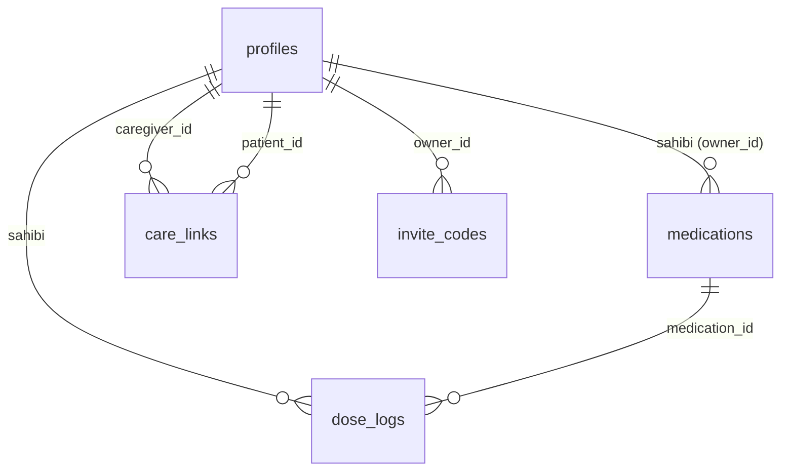
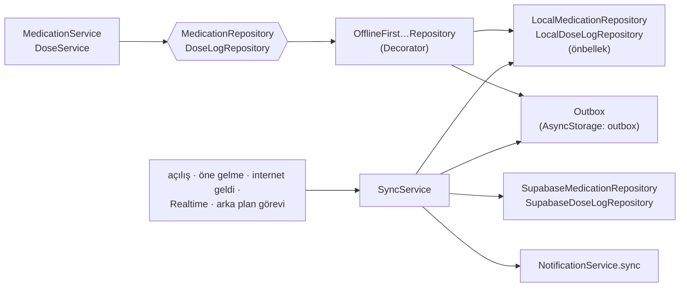

# 2. Tur, 2. Parça Planı: İlaçların Buluta Taşınması, Davet Kodu ve Aile Paneli

**Tarih:** 26 Kasım 2026 · **Dal:** `feature/tur2-aile` (`main`'den, `v0.4-hesap-kalite` etiketinden sonra) · **Durum:** Onay bekliyor

Bu belge kod yazılmadan önceki plandır. Onaylanınca adımlar aşağıdaki sırayla, TDD ile ve ayrı commit grupları halinde uygulanacak. Kararlar uygulandıkça `docs/kararlar.md`'ye ADR olarak geçecek (ADR-021…024, bkz. bölüm j).

**Temel ilke:** Yaşlının telefonu internetsiz de tam çalışmaya devam eder. Hatırlatmalar yereldir (ADR-001), sunucu yalnızca kopyalama ve aileyle paylaşma içindir. Bugünkü katmanlar korunur. Repository arayüzleri (ADR-020) bu parçanın girişidir; servisler ve ekranlar olabildiğince değişmez.

---

## a) Veritabanı tabloları

### Adlandırma

`profiles` tablosunda sütunlar Türkçe (`ad`, `rol`). Bu parçada istenen adlar ise karışık: `updated_at`, `deleted_at`, `cihaza_ulasti_zamani`. **Öneri:**

- Tablo ve sütun adları İngilizce `snake_case` olsun, ilaç modelindeki alanların karşılığı olsun (`meal_timing` ↔ `mealTiming`). Çeviri tek bir eşleme fonksiyonuyla yapılır, yanlış ad derlemede yakalanır (`npm run tipler`).
- `cihaza_ulasti_zamani` istendiği gibi Türkçe kalsın. Açık soru 1'e bakın: tutarlılık için `delivered_at` de olabilir.

### `medications`

| Sütun                              | Tip             | Kural                                                                                                                                 |
| ---------------------------------- | --------------- | ------------------------------------------------------------------------------------------------------------------------------------- |
| `id`                               | `text` PK       | Telefonda üretilir. Bugünkü kimlikler aynen yüklenir; doz kimliği (`ilacId_tarih_saat`) bozulmaz. Yeni kimlikler UUID olacak.         |
| `owner_id`                         | `uuid` not null | → `profiles(id)` `on delete cascade`. İlacı kullanan kişi (sade veya standart).                                                       |
| `created_by`                       | `uuid`          | → `profiles(id)` `on delete set null`. İlacı ekleyen (kendisi veya aile üyesi).                                                       |
| `name`, `dose`, `unit`, `location` | `text` not null | Uzunluk sınırı (ad 1–100, diğerleri ≤ 100).                                                                                           |
| `form`                             | `text` not null | `check` ile on form (`tablet` … `other`).                                                                                             |
| `amount`                           | `numeric(6,1)`  | `> 0`.                                                                                                                                |
| `meal_timing`                      | `text`          | `check in ('empty','full','any')`.                                                                                                    |
| `times`                            | `text[]`        | En az bir saat; her biri `HH:mm` (`check`).                                                                                           |
| `schedule`, `duration`             | `jsonb`         | Bugünkü JSON biçimi aynen (`{"kind":"daily"}`). Uygulamada zod şeması denetler (ADR-020).                                             |
| `start_date`                       | `date`          |                                                                                                                                       |
| `past_plans`                       | `jsonb`         | Varsayılan `'[]'`.                                                                                                                    |
| `stock`                            | `numeric(5,1)`  | `0–999`, 0,5 adımlı.                                                                                                                  |
| `low_stock_threshold`              | `numeric(5,1)`  | `null` = uyarı kapalı.                                                                                                                |
| `marked_low`                       | `boolean`       | Varsayılan `false`.                                                                                                                   |
| `photo_path`                       | `text`          | Storage'daki yol (`{owner_id}/…jpg`); fotoğraf yoksa `null`.                                                                          |
| `created_at`                       | `timestamptz`   | Telefondaki `createdAt`.                                                                                                              |
| `updated_at`                       | `timestamptz`   | **Değişikliği yapan telefonun saati.** "Son yazan kazanır" bununla karşılaştırılır.                                                   |
| `server_updated_at`                | `timestamptz`   | Tetikleyici her yazmada `now()` yazar. Telefon "son çekmeden beri değişenleri" bununla sorar (telefon saati yanlış olsa da kaçırmaz). |
| `deleted_at`                       | `timestamptz`   | Yumuşak silme. Doz geçmişi silinmiş ilacın adını gösterebilsin diye satır kalır.                                                      |
| `cihaza_ulasti_zamani`             | `timestamptz`   | Yaşlının telefonu bu sürümü alıp hatırlatmaları kurunca doldurur. İlaç değişince tetikleyici `null` yapar.                            |

**Tetikleyiciler:**

- `server_updated_at` her yazmada `now()` olur.
- Gelen `updated_at` mevcut satırdakinden eskiyse güncelleme yok sayılır. Böylece geç gönderilen eski bir değişiklik yeniyi ezmez.
- `owner_id` ve `created_by` güncellemede değiştirilemez.
- Plan, ad, doz, fotoğraf veya silinme değişirse `cihaza_ulasti_zamani` `null` olur. İlacın sahibi kendi telefonundan değiştirdiyse tetikleyici `now()` yazar, çünkü değişiklik zaten o telefondadır.

**İndeksler:**

- `(owner_id) where deleted_at is null`: ilaç listesi.
- `(owner_id, server_updated_at)`: artımlı çekme.

### `dose_logs`

| Sütun                             | Tip             | Kural                                                                                                              |
| --------------------------------- | --------------- | ------------------------------------------------------------------------------------------------------------------ |
| `id`                              | `text` PK       | Bugünkü tekil kimlik `ilacId_YYYY-MM-DD_HH:mm`. Aynı doz iki kez yazılamaz; tekrar gönderim çift kayıt oluşturmaz. |
| `owner_id`                        | `uuid` not null | → `profiles(id)` `on delete cascade`.                                                                              |
| `medication_id`                   | `text` not null | → `medications(id)` `on delete cascade` (yumuşak silmede satır kalır).                                             |
| `scheduled_date`                  | `date`          | Planlanan gün (yerel takvim).                                                                                      |
| `scheduled_time`                  | `text`          | Planlanan saat, `HH:mm`. Kimlik yerel saatle kurulduğu için `timestamptz` değil, gün + saat.                       |
| `status`                          | `text`          | `check in ('alindi','atlandi')`. Varsayılan `alindi`.                                                              |
| `taken_at`                        | `timestamptz`   | `alindi` ise zorunlu, `atlandi` ise `null` (`check`).                                                              |
| `created_at`, `server_updated_at` | `timestamptz`   | Çekme imleci için.                                                                                                 |

- `check`: `id = medication_id || '_' || scheduled_date || '_' || scheduled_time`. Kimlik ile alanlar ayrışamaz.
- **İndeksler:** `(owner_id, scheduled_date desc)` (Geçmiş sayfalaması), `(owner_id, server_updated_at)` ve `(medication_id)`.
- Telefondaki `DoseLog` kaydına isteğe bağlı `status` alanı eklenir (şema v3; yoksa `alindi`). "Bu dozu atla" arayüzü bu parçada yok (açık soru 6), ama sütun şimdiden hazır.

### `care_links`

| Sütun            | Tip           | Kural                                                    |
| ---------------- | ------------- | -------------------------------------------------------- |
| `id`             | `uuid` PK     | `gen_random_uuid()`                                      |
| `caregiver_id`   | `uuid`        | → `profiles(id)` `on delete cascade`. Aile üyesi.        |
| `patient_id`     | `uuid`        | → `profiles(id)` `on delete cascade`. Takip edilen kişi. |
| `relation_label` | `text`        | "Annem", "Babam"… 1–40 karakter.                         |
| `created_at`     | `timestamptz` |                                                          |

- `unique (caregiver_id, patient_id)`: aynı çift bir kez bağlanır. `check (caregiver_id <> patient_id)`.
- Bir aile üyesi birden çok kişiyi, bir kişi birden çok aile üyesini bağlayabilir.
- İndeks: `unique` zaten `(caregiver_id, patient_id)` sırasındadır. Ek olarak `(patient_id)` ("Bağlı yakınlarım" listesi için).

### `invite_codes`

| Sütun        | Tip           | Kural                                           |
| ------------ | ------------- | ----------------------------------------------- |
| `id`         | `uuid` PK     |                                                 |
| `code`       | `char(6)`     | Yalnızca rakam (`check (code ~ '^[0-9]{6}$')`). |
| `owner_id`   | `uuid`        | Kodu oluşturan, takip edilecek kişi.            |
| `expires_at` | `timestamptz` | `now() + interval '24 hours'`.                  |
| `used_at`    | `timestamptz` | Kullanılınca dolar; kod tek kullanımlıktır.     |
| `used_by`    | `uuid`        | Kodu kullanan aile üyesi.                       |
| `created_at` | `timestamptz` |                                                 |

- `unique (code) where used_at is null`: kullanılmamış iki kod aynı olamaz.
- Kişi başına tek etkin kod vardır. Yeni kod istenince eski kullanılmamış kod geçersiz olur.

### `invite_attempts` (yalnızca RPC kullanır)

| Sütun          | Tip           | Kural                                   |
| -------------- | ------------- | --------------------------------------- |
| `user_id`      | `uuid`        | Deneyen kullanıcı.                      |
| `attempted_at` | `timestamptz` | İndeks: `(user_id, attempted_at desc)`. |

### İlişkiler

### Uygulamadaki model değişikliği (şema v3, cihaz)

- `Medication`'a `updatedAt` (yoksa `createdAt`) ve `photoPath` (yoksa `''`) eklenir.
- `DoseLog`'a `status` eklenir (yoksa `alindi`).
- Eski anahtar ve alan adları değişmez (CLAUDE.md kuralı). Yeni anahtarlar: `outbox`, `syncState`.

---

## b) RLS kuralları

Yardımcı fonksiyon `is_caregiver_of(patient uuid)`: `security definer`, `stable`, boş `search_path`. "Oturumdaki kullanıcı bu kişiye bağlı aile üyesi mi?" sorusunu sorar. Politikalarda `(select …)` ile çağrılır, böylece Postgres onu satır başına değil sorgu başına bir kez hesaplar.

| Tablo                                   | İşlem               | Kişinin kendisi (`owner`)                                                                                     | Bağlı aile üyesi                                      | Diğer herkes, `anon` |
| --------------------------------------- | ------------------- | ------------------------------------------------------------------------------------------------------------- | ----------------------------------------------------- | -------------------- |
| `profiles`                              | okuma               | kendi satırı (var)                                                                                            | bağlı olduğu kişinin satırı (yeni)                    | yok                  |
| `profiles`                              | güncelleme          | `ad`, `rol` (var)                                                                                             | yok                                                   | yok                  |
| `medications`                           | okuma               | var                                                                                                           | var                                                   | yok                  |
| `medications`                           | ekleme              | var (`owner_id = uid`)                                                                                        | var (`is_caregiver_of(owner_id)`, `created_by = uid`) | yok                  |
| `medications`                           | güncelleme          | var                                                                                                           | var                                                   | yok                  |
| `medications`                           | silme               | yalnızca `deleted_at` ile (güncelleme). Gerçek `delete` izni kimsede yok, yalnızca hesap silinince `cascade`. | aynı                                                  | yok                  |
| `dose_logs`                             | okuma               | var                                                                                                           | var                                                   | yok                  |
| `dose_logs`                             | ekleme              | var                                                                                                           | **yok**                                               | yok                  |
| `dose_logs`                             | güncelleme, silme   | var                                                                                                           | **yok**                                               | yok                  |
| `care_links`                            | okuma               | kendi bağlantıları (hasta tarafı)                                                                             | kendi bağlantıları (aile tarafı)                      | yok                  |
| `care_links`                            | ekleme              | yok, yalnızca RPC                                                                                             | yok, yalnızca RPC                                     | yok                  |
| `care_links`                            | güncelleme          | yok                                                                                                           | yalnızca `relation_label`                             | yok                  |
| `care_links`                            | silme               | var ("bağlantıyı kaldır")                                                                                     | var                                                   | yok                  |
| `invite_codes`                          | okuma               | kendi kodları                                                                                                 | yok                                                   | yok                  |
| `invite_codes`                          | yazma               | yok, yalnızca RPC                                                                                             | yok                                                   | yok                  |
| `invite_attempts`                       | hepsi               | yok                                                                                                           | yok                                                   | yok                  |
| `storage.objects` (`ilac-fotograflari`) | okuma, yazma, silme | yol `{kendi id}/…`                                                                                            | yol `{takip ettiği kişinin id}/…`                     | yok                  |

**Ek kısıtlar:**

- `profiles` migration'ındaki gibi `revoke all … from anon, authenticated` uygulanır, ardından yalnızca gereken `grant`'lar verilir. Örneğin `care_links` için `grant update (relation_label)`.
- `with check` ifadeleri `using` ile aynıdır. Aile üyesi bir ilacı başka birine "taşıyamaz"; ayrıca `owner_id` değişikliğini tetikleyici reddeder.
- Realtime de RLS'ye uyar. `medications` ve `dose_logs` yayına (`supabase_realtime`) eklenir.

### RPC fonksiyonları (`security definer`, `set search_path = ''`, `anon`'dan `revoke execute`)

| Fonksiyon                                  | Kim çağırır     | Ne yapar                                                                                                                                                                                                                                                                                                                                                                                       |
| ------------------------------------------ | --------------- | ---------------------------------------------------------------------------------------------------------------------------------------------------------------------------------------------------------------------------------------------------------------------------------------------------------------------------------------------------------------------------------------------- |
| `create_invite_code()`                     | sade, standart  | Önceki kullanılmamış kodu geçersiz yapar. Etkin kodlarla çakışmayan rastgele 6 hane üretir (`gen_random_bytes`, tekrar dener). Kodu ve bitiş anını döner.                                                                                                                                                                                                                                      |
| `redeem_invite_code(code, relation_label)` | aile            | 1) Son 1 saatteki denemeleri sayar; 5 veya fazlaysa `too_many_attempts` hatası verir. 2) Denemeyi kaydeder (başarılı da sayılır). 3) Kod yoksa, süresi dolmuşsa, kullanılmışsa veya kişinin kendi koduysa tek bir `invalid_code` hatası verir; saldırgan hangisi olduğunu öğrenemez. 4) Bağlantıyı ekler (`on conflict do nothing`), kodu kullanıldı yapar. 5) Kişinin `id` ve `ad`'ını döner. |
| `record_dose(log, amount)`                 | kişinin kendisi | Doz kaydını ekler (`on conflict do nothing`). Yalnızca yeni eklendiyse stoğu `greatest(stock - amount, 0)` ile düşer. Tek işlemdir ve tekrar gönderilse de stok bir kez düşer (`DoseLogRepository.recordDose` sözleşmesi).                                                                                                                                                                     |
| `mark_delivered(items)`                    | kişinin kendisi | `[{id, server_updated_at}]` alır. `cihaza_ulasti_zamani`'nı yalnızca sürüm hâlâ aynıysa doldurur; arada aile yeniden değiştirdiyse dokunmaz.                                                                                                                                                                                                                                                   |

- **Rol denetimi:** `redeem_invite_code`'u yalnızca `rol = 'aile'` olan kullanıcı çağırabilir, kodun sahibi de `sade` veya `standart` olmalıdır (açık soru 5).
- **Hata kodları:** Hatalar `toAuthError` tablosu gibi bir tabloyla Türkçeye çevrilir:
  - `invalid_code`: "Kod geçersiz veya süresi dolmuş. Yakınınızdan yeni kod isteyin."
  - `too_many_attempts`: "Çok fazla deneme yapıldı. Lütfen bir saat sonra tekrar deneyin."

---

## c) Fotoğraflar

- **Bucket:** `ilac-fotograflari`, özel (`public = false`), dosya sınırı 2 MB, yalnızca `image/jpeg`.
- **Yol:** `{owner_id}/{medication_id}-{zaman}.jpg`. Değişen fotoğraf yeni adla yüklenir (ADR-012'deki önbellek gerekçesi), eskisi ancak ilaç kaydı yazıldıktan sonra silinir.
- **RLS (`storage.objects`):** `bucket_id = 'ilac-fotograflari'`, `(storage.foldername(name))[1] = (select auth.uid())::text` ya da `is_caregiver_of` bu klasör sahibi için doğru olmalı. Okuma, yükleme, güncelleme ve silme için ayrı kurallar yazılır.
- **Sıkıştırma (yüklemeden önce, telefonda):** `expo-image-manipulator` (SDK 58 API'si: `ImageManipulator.manipulate(uri).resize(...)` → `renderAsync()` → `saveAsync({ format: SaveFormat.JPEG, compress: 0.7 })`).
  - Uzun kenar 1080 pikseli geçiyorsa 1080'e iner, en-boy oranı korunur. Küçük fotoğraf büyütülmez.
  - Saf karar fonksiyonu `resizeTarget(width, height, 1080)` `utils/`'de olur ve tek başına test edilir. Kütüphane çağrısı `PhotoCompressor` adaptöründe kalır.
  - Tahmini boyut: 1080 × 810 JPEG %70 ≈ 120–200 KB. Ücretsiz plandaki 1 GB alana binlerce fotoğraf sığar.
- **Gösterim:**
  - Fotoğraf telefonda dosya olarak da tutulur (bugünkü `photoFile`, ADR-012); yerel dosya varsa her zaman o gösterilir, internetsiz de görünür.
  - Aile eklediyse yaşlının telefonu fotoğrafı eşitleme sırasında **bir kez** indirir. Bunun için imzalı URL (`createSignedUrl`, 1 saat) kullanılır, dosya yereldeki `photos/` klasörüne yazılır.
  - Aile panelinde imzalı URL bellekte süresi dolana kadar saklanır. `expo-image` disk önbelleği için `cacheKey` olarak URL değil `photo_path` verilir; böylece her yeni imzalı URL fotoğrafı yeniden indirtmez.

---

## d) Eşitleme tasarımı (çevrimdışı öncelikli)

### Bileşenler (Repository + Decorator)

- **`SupabaseMedicationRepository` ve `SupabaseDoseLogRepository`:** Mevcut arayüzleri uygular.
  - `ownerId` constructor ile verilir: kendi telefonunda kendi kimliği, aile panelinde takip edilen kişinin kimliği.
  - Satırlar zod şemasıyla doğrulanır (ADR-020). Satır ↔ model çevirisi tek fonksiyondadır.
  - `remove`, `deleted_at` yazar. `recordDose`, `record_dose` RPC'sini çağırır.
  - Sözleşme testleri cihaz ve sunucu uygulamalarında aynı test setiyle çalışır, ikisinin aynı davrandığını gösterir.
- **`OfflineFirstMedicationRepository` (Decorator):** Aynı arayüzü uygular. Her yazmayı önce `Local…`'a, sonra outbox'a yazar ve hemen döner. Hatırlatma ve ekran internet beklemez.
  - `services/index.ts`'de yalnızca iki repository satırı değişir. `MedicationService` ve `DoseService` değişmez (ADR-020'nin vaadi).
- **`Outbox`:** Yeni AsyncStorage anahtarı `outbox`. Kayıt türleri:
  - `upsertMedication`, `deleteMedication`, `recordDose` ve `uploadPhoto`;
  - her kayıtta `id`, `createdAt` ve `attempts` alanları vardır.
  - Aynı ilacın birbirini izleyen `upsert`'leri tek kayda indirilir (yalnızca son hâl gönderilir).
  - Sıra korunur: fotoğraf yüklemesi ilaç kaydından önce gider.
- **`SyncService`:** Saf mantık; dış dünyayı arayüzlerle alır (saat, repository'ler, outbox, ağ durumu).
  - **`push()`:** Kuyruğu baştan sona gönderir.
    - Ağ hatasında durur ve bekleme süresi artar (30 sn → 5 dk).
    - Kalıcı hata (RLS reddi, doğrulama) kuyruğu tıkamaz: kayıt `outbox.hatali` anahtarına taşınır ve `logger.error` ile yazılır.
    - Doz kimliği tekil, ilaç yazması `updated_at` korumalı olduğu için aynı kaydın tekrar gönderilmesi zararsızdır.
  - **`pull()`:** `server_updated_at > imleç` olan ilaç ve doz satırlarını çeker; silinmişler de gelir. İmleç `syncState` anahtarında tutulur.
    - Çakışma: aynı ilaç outbox'ta bekliyorsa `updated_at` karşılaştırılır, **son yazan kazanır**. Bekleyen yoksa sunucudaki kayıt alınır.
    - Doz kayıtları değişmez olduğu için birleştirme yeterlidir.
  - **Çekmeden sonra:** Değişen bir şey varsa `NotificationService.sync` çalışır, ardından `mark_delivered` RPC'si çağrılır. "Henüz telefona ulaşmadı" uyarısı tam olarak bu adımda kalkar: hatırlatma kurulmadan "ulaştı" denmez.
- **Ne zaman çalışır:**

| Tetik                                     | Yapılan                                   | Not                                                                                                                                                                                      |
| ----------------------------------------- | ----------------------------------------- | ---------------------------------------------------------------------------------------------------------------------------------------------------------------------------------------- |
| Uygulama açılışı                          | önce yerel yükleme, sonra `push` + `pull` | Ekran yerel veriyle hemen açılır; sunucu beklenmez.                                                                                                                                      |
| Öne gelme (AppState `active`)             | `push` + `pull`                           | Bugünkü `useReminderSync` ile aynı yer.                                                                                                                                                  |
| İnternet geldi                            | `push`                                    | `expo-network` `addNetworkStateListener`. iOS'ta `isInternetReachable` her zaman `isConnected` ile aynı olduğundan asıl karar istek sonucuna göre verilir.                               |
| Realtime (uygulama açıkken)               | `pull`                                    | `medications` için `owner_id=eq.<kendi id>` filtresi. Gelen olayın içeriği doğrudan uygulanmaz, yalnızca çekmeyi tetikler (tek doğru yol). Uygulama arka plana geçince abonelik kapanır. |
| Arka plan görevi (`expo-background-task`) | `push` + `pull` + hatırlatma eşitleme     | İstenen aralık 15 dk (Android'de en küçük değer). **iOS bunu garanti etmez** (açıklama aşağıda).                                                                                         |

- **Arka plan görevi neden güvenilmez:** iOS'ta `BGTaskScheduler`, Android'de `WorkManager` kullanılır (SDK 58 belgesi).
  - iOS aralığı yalnızca öneri sayar; kısa aralıkları çoğu zaman yok sayar, görevi gece şarjdayken çalıştırabilir.
  - Pil düşükse veya ağ yoksa görev çalışmaz.
  - Kullanıcı uygulamayı uygulama değiştiriciden kaydırıp kapatırsa görev uygulama yeniden açılana kadar hiç çalışmaz.
  - iOS simülatöründe hiç çalışmaz; yalnızca gerçek telefonda denenebilir.
  - Push bildirimi de kapalı (ADR-001). Bu yüzden **aile yeni ilaç eklediğinde yaşlının telefonu bunu en geç uygulama açıldığında alır**. Aile bunu "Henüz telefona ulaşmadı" uyarısından görür.
- **İlk girişte telefondaki ilaçların yüklenmesi:**
  - `syncState.ownerId` boşsa (bu telefon daha önce hiçbir hesapla eşitlenmediyse), sade veya standart kullanıcı ilk girdiğinde telefondaki bütün ilaçlar, doz kayıtları ve fotoğraflar outbox'a yazılır ve gönderilir.
  - Ardından `ownerId` yazılır. Sunucuda aynı kimlikli ilaç varsa son yazan kazanır, yani tekrar yükleme zarar vermez.
  - Telefondaki veri **başka** bir hesaba aitse (`ownerId` farklıysa) yüklenmez. Bu durumda yerel önbellek temizlenir, ama gönderilmemiş outbox kaydı varsa önce kullanıcıya sorulur (açık soru 3).
- **Aile tarafı:** Aile üyesi takip ettiği kişi için çevrimiçi çalışır. Yazmalar doğrudan `Supabase…Repository`'ye gider, outbox kullanılmaz.
  - Gerekçe: Değişikliğin bir anlamı olması için zaten yaşlının telefonuna ulaşması gerekir; internetsiz kaydı "kaydedildi" diye göstermek yanıltıcı olurdu.
  - İnternet yoksa Türkçe hata gösterilir; son çekilen liste salt okunur görünür.
  - **Aile telefonu takip ettiği kişinin hatırlatmalarını kurmaz**: o kişi için kurulan `MedicationService`'e boş (`no-op`) `ReminderScheduler` verilir.

---

## e) iOS 64 bildirim sınırı

### Bugün `ReminderPlanner` kaç bildirim kuruyor?

| İlaç türü                          | Kurulan bildirim                        | Sınıra tabi mi?                 |
| ---------------------------------- | --------------------------------------- | ------------------------------- |
| Sürekli, her gün, `t` saat         | `t` (tekrarlanan günlük)                | **Kırpılmaz**                   |
| Sürekli, haftada `g` gün, `t` saat | `g × t` (tekrarlanan haftalık)          | **Kırpılmaz**                   |
| Süreli, `n` gün, `t` saat          | kalan günlerdeki `≤ n × t` tek seferlik | 60'tan kalan yere sığdığı kadar |
| Erteleme (`ertele-…`), test        | Her ertelenen doz için 1                | Sayıya katılmıyor               |

- Toplam = `Σ t (günlük) + Σ g·t (haftalık) + min(kalan, süreli)`. **Üst sınır yok**: tekrarlanan bildirimler hiç kırpılmıyor. Sihirbazda saat sayısına da sınır yok.
- iOS, 64'ten fazla bekleyen bildirimden en yakın 64'ünü tutar, gerisini **sessizce atar**. Hangi dozun hatırlatılmadığı uygulamaca bilinmez.
- **Örnekler:**
  - Günde 3 kez 5 ilaç = 15 bildirim. Sorun yok.
  - Pazartesi–cumartesi 3 kez 4 ilaç = 4 × 6 × 3 = **72**. Sınır aşılıyor.
  - Günde 2 kez 4 sürekli ilaç (8) + 10 günlük, günde 3 kez antibiyotik (30) = 38. Sorun yok.
  - Günde 4 kez 15 ilaç = 60. Erteleme için yer kalmıyor.
- Aile birden fazla kişinin ilacını ekleyebildiği için (ve yaşlıda çoklu ilaç kullanımı yaygın olduğundan) toplam artık yaşlının bilgisi dışında da büyüyebilir.

### Önerilen strateji: tek bütçe, en yakın doz önce

1. `ReminderPlanner.plan` bütçeyi tek yerden hesaplar: **60 bildirim**, iOS'un 64'ünden 4'ü erteleme ve test için ayrılır. Planlayıcı bekleyen erteleme sayısını da alır ve bütçeden düşer.
2. **Tekrarlanan bildirimler bütçeye sığıyorsa** bugünkü gibi kurulur (en az bildirim, uygulama açılmasa da sonsuza kadar çalışır).
3. **Sığmıyorsa** "kayan pencere" kipine geçilir:
   - Bütün dozlar (sürekli dahil) önümüzdeki günler için **tek seferlik** bildirime çevrilir.
   - Zamana göre sıralanır, en yakın 59'u kurulur.
   - 60. bildirim, son kurulan dozun saatinde gelir: "Hatırlatmaların devamı için uygulamayı açın." Uygulama açılmazsa hatırlatmaların sessizce bitmesi böylece önlenir.
4. Pencere uygulama her açıldığında, öne geldiğinde, eşitlemeden sonra ve arka plan görevinde yenilenir. Kimlikler belirleyici olduğu için (`…-YYYY-MM-DD`) yalnızca fark kurulur ve silinir; bugünkü `sync` mantığı aynen kalır.
5. **Pencere süresi:** Günde `d` dozda `⌊59 / d⌋` gün. Örnekte 72 / 7 ≈ 10 doz/gün → **5 gün**.
   - Pencere 2 günden kısalırsa Ayarlar'da ve ana ekranda uyarı gösterilir: "Çok sayıda hatırlatma var; uygulamayı her gün açın."
   - Aile panelinde de aynı kişi için bilgi verilir.
6. Android'de sınır yok, ama aynı kod çalışır; davranış iki platformda aynı kalsın diye tek strateji seçildi.
7. **Testler:**
   - Hiçbir girdiyle 60 aşılmıyor (rastgele ilaç listeleriyle tekrarlı test).
   - Seçilenler en yakın dozlar.
   - Sığan durumda çıktı bugünküyle birebir aynı (karakterizasyon testi önce yazılır).

---

## f) Performans

- **İndeksler:** a) bölümündeki `(owner_id …)`, `(owner_id, scheduled_date desc)` ve `(owner_id, server_updated_at)`. RLS yardımcı fonksiyonu `(select …)` ile sorgu başına bir kez çalışır. Supabase Performance Advisor migration'dan sonra yeniden çalıştırılır.
- **Artımlı çekme:** İmleçten sonra değişenler gelir, her açılışta tüm tablo indirilmez. Sütunlar açıkça seçilir (`select('*')` yok).
- **Geçmiş sayfalaması:**
  - Yaşlının telefonu doz kayıtlarını zaten yerelde tutar. Yılda 10 doz/gün ile ≈ 3.650 kayıt ≈ 400 KB eder, sorun değil.
  - Aile tarafındaki Geçmiş ekranı hafta hafta çeker: `scheduled_date between pazartesi and pazar`, sayfa başına bir hafta. Önceki haftaya geçişte bir sorgu daha atılır ve çekilen haftalar bellekte tutulur.
  - Aile paneli için yalnızca bugünün dozları çekilir.
- **Fotoğraf önbelleği:** c) bölümünde. Yerel dosya önce gösterilir; imzalı URL süresince saklanır; `expo-image` önbellek anahtarı yoldur.
- **Realtime:** Kanal başına tek filtre, yalnızca uygulama öndeyken açık. Ücretsiz planın eşzamanlı bağlantı sınırı prototip için yeterli.
- **Toplu gönderim:** Outbox `push`'ta ilaç upsert'leri tek istekte birleştirilir.

---

## g) Ekranlar ve gezinme

Stitch'te çizilenler: 16 Ailemi Bağla, 17 Kodla Bağlan, 18 Aile Paneli. Metin ve ölçüler `arayuz-tasarimi.md`'deki kurallara uyar: en küçük yazı 16pt (Sade'de 20pt), yüzde yazılmaz, "Annemi ara" düğmesi olmaz.

| Ekran                                                | Kim            | Nereden                                                        | İçerik                                                                                                                                                                                                                                                                                                                                                                                    |
| ---------------------------------------------------- | -------------- | -------------------------------------------------------------- | ----------------------------------------------------------------------------------------------------------------------------------------------------------------------------------------------------------------------------------------------------------------------------------------------------------------------------------------------------------------------------------------- |
| **Ailemi Bağla** (`ailemi-bagla`)                    | sade, standart | Ayarlar > "Ailemi bağla"                                       | Büyük 6 haneli kod ("482 913"), "Kod 24 saat geçerlidir", "Kodu paylaş" (React Native `Share`; yeni paket gerekmez), "Yeni kod al", bağlı yakınlar listesi ("Ayşe Bulut · Kızınız") ve onaylı "Bağlantıyı kaldır". Altta gizlilik notu.                                                                                                                                                   |
| **Kodla Bağlan** (`kodla-baglan`)                    | aile           | Kayıttan sonra ilk ekran; panelde "+ Başka bir yakınımı bağla" | Tek, rakam klavyeli 6 hane alanı; yakınlık seçimi (Annem, Babam, Eşim, Diğer → serbest metin); "Bağlan". Hatalar Türkçe.                                                                                                                                                                                                                                                                  |
| **Aile Paneli** (`aile/index`)                       | aile           | Aile ana ekranı (bugünkü geçici `aile.tsx`'in yerine)          | Selamlama ve dişli. Kırmızı uyarı kartları ("Annem 09:00 dozunu almadı · 45 dakika geçti"). Her takip edilen kişi için bir kart: baş harfler, ad, "Annem · Sade mod", "Bugün 1 / 3 ilaç alındı", günün dozları (renk + ikon + yazı), ulaşmayan ilaçlarda amber "Henüz telefona ulaşmadı". Kartta "İlaç ekle", "İlaçları yönet", "Geçmiş". Hiç bağlantı yoksa "Yakınımı bağla" boş durumu. |
| **İlaç ekle** (`aile/[kisiId]/ilac-ekle`)            | aile           | Kişi kartı                                                     | Mevcut 9 adımlı sihirbaz; üst başlıkta "Fatma Bulut için".                                                                                                                                                                                                                                                                                                                                |
| **İlaçları yönet** (`aile/[kisiId]/ilaclar`)         | aile           | Kişi kartı                                                     | Mevcut İlaçlarım listesi; düzenle ve sil o kişinin ilacına uygulanır. Ulaşmayan ilaçta amber uyarı.                                                                                                                                                                                                                                                                                       |
| **İlaç düzenle** (`aile/[kisiId]/ilac-duzenle/[id]`) | aile           | İlaçları yönet                                                 | Mevcut sihirbaz, özet adımından.                                                                                                                                                                                                                                                                                                                                                          |
| **Geçmiş** (`aile/[kisiId]/gecmis`)                  | aile           | Kişi kartı                                                     | Mevcut Geçmiş haftası, hafta hafta sunucudan.                                                                                                                                                                                                                                                                                                                                             |

**Mevcut ekranları değiştirmeden kullanma yolu:**

- `aile/[kisiId]/_layout.tsx`, o kişi için kurulmuş servislerle bir `MedicationsProvider` açar. Servisler şunlardır:
  - `Supabase…Repository(ownerId = kisiId)`;
  - boş hatırlatıcı;
  - ortak fotoğraf servisi.
- Sihirbaz, İlaçlarım ve Geçmiş kancaları (`useMedications`, `useMedicationWizard`, `useHistoryWeek`) aynen çalışır; hangi kişinin verisi olduğunu sağlayıcı belirler (Dependency Injection'ın asıl getirisi).
- Kişinin adı küçük bir `useCareSubject()` kancasıyla başlığa verilir.
- Bugün yalnızca kök `_layout.tsx` sağlayıcı kurabiliyor; katman kuralı bu yeni düzen dosyasını da kapsayacak şekilde genişletilir.

**Yönlendirme (`homeRouteOf`):**

- Aile rolünde yeni kayıttan sonra Bildirim izni → Kodla Bağlan → Aile Paneli.
- Girişte doğrudan Aile Paneli; bağlantı yoksa panel boş durumu "Yakınımı bağla" gösterir. Yönlendirme bağlantı listesinin yüklenmesini beklemez.

**Sade mod:** İlaç ekleme yine gizlidir (ADR-015). Ayarlar'a "Ailemi bağla" satırı eklenir. Aile ilaç eklediğinde Sade ana ekran Realtime veya açılış eşitlemesiyle kendiliğinden güncellenir.

**Yeni kancalar:**

- `useInviteCode`, `useCareLinks`, `useRedeemCode` (hepsi yeni `CareService` üzerinden);
- `useFamilyDashboard` (bağlı kişiler, bugünün dozları; `DoseCalculator` yeniden kullanılır);
- `useSyncStatus` (Ayarlar'da "Son eşitleme: 2 dk önce", "Gönderilmeyi bekleyen 2 değişiklik").

---

## h) Test planı

### 1. Birim testleri (Jest, `npm run kontrol` ve CI'da)

| Konu                      | Nasıl                                                                                                                                                                                                                                                            |
| ------------------------- | ---------------------------------------------------------------------------------------------------------------------------------------------------------------------------------------------------------------------------------------------------------------- |
| Satır ↔ model çevirisi    | zod şemaları; bozuk satır atlanır, `logger.warn` yazılır.                                                                                                                                                                                                        |
| Supabase repository'leri  | Sahte sorgu nesnesi (`Pick<SupabaseClient<Database>, 'from' \| 'rpc'>`). Gönderilen filtre ve sütunlar denetlenir. Cihaz ve sunucu uygulaması **aynı sözleşme testleriyle** çalışır.                                                                             |
| `OfflineFirst…`, `Outbox` | Yazma önce yerele ve kuyruğa; ardışık güncellemeler birleşir; sıra korunur; kalıcı hata kuyruğu tıkamaz.                                                                                                                                                         |
| `SyncService`             | Sahte saat, sahte ağ: internetsiz yazma → internet gelince gönderim; aynı kaydın iki kez gönderilmesi; son yazan kazanır (iki yönde); imleç; silinmiş kayıt; ilk girişte yükleme; başka hesabın verisi yüklenmez; çekmeden sonra hatırlatma ve `mark_delivered`. |
| Davet kodu                | Girdi doğrulama (6 rakam, boşluk ve tire temizliği), hata tablosu, kancalar.                                                                                                                                                                                     |
| Bildirim bütçesi          | e) bölümündeki testler.                                                                                                                                                                                                                                          |
| Fotoğraf                  | `resizeTarget` saf fonksiyonu; `PhotoCompressor` sahte manipulator ile.                                                                                                                                                                                          |
| Ekranlar                  | Aile Paneli, Kodla Bağlan, Ailemi Bağla: sahte servislerle render testleri ve 48pt dokunma testi.                                                                                                                                                                |

### 2. RLS entegrasyon testleri (gerçek projeye karşı; CI'da çalışmaz)

- **Komut ve ayar:**
  - Komut `npm run test:rls`. Testler `app/rls-tests/` klasöründedir ve ayrı `jest.rls.config.js` ile çalışır; `npm test` ve CI bu klasörü hiç görmez.
  - Ortam `app/.env.test` dosyasından okunur (commit edilmez, `.env.test.example` boş değerlerle depoda): proje adresi, publishable anahtar ve test hesaplarının e-posta ve şifreleri.
  - **Secret anahtar kullanılmaz**: testler gerçek kullanıcı gibi oturum açar, böylece RLS gerçekten denenir.
- **Test kullanıcıları** (bir kez kayıt olunur, test verisi):
  - **A** sade: takip edilen;
  - **B** aile: A'ya bağlanır;
  - **C** aile: bağlı değil, "yabancı";
  - **D** aile: yalnızca deneme sınırı testi için.
  - Oturumsuz istemci (`anon`) de denenir.
- **Matris:** Her tablo ve işlem için (okuma, ekleme, güncelleme, silme, RPC) A, B, C ve `anon` ile beklenen sonuç tabloyla yazılır ve `it.each` ile çalıştırılır. Bu, b) bölümündeki tablonun çalıştırılabilir hâlidir. Örnekler:
  - B, A'nın ilacını ekler, düzenler ve siler → izinli.
  - B, A'nın doz kaydını yazar → reddedilir.
  - C, A'nın hiçbir satırını görmez (boş sonuç).
  - A, `care_links`'e doğrudan satır ekleyemez.
  - B, `owner_id`'yi C yapamaz.
  - C, A'nın fotoğraf yolunu okuyamaz.
- **Akış testleri:**
  - A kod üretir → B kodla bağlanır → bağlantı oluşur.
  - Aynı kod ikinci kez kullanılamaz.
  - D'nin 6. denemesi `too_many_attempts` alır. Saatlik sınır yüzünden bu test saatte bir kez çalıştırılabilir ve ayrı bir `describe` ile işaretlidir.
  - `record_dose` iki kez çağrılınca stok bir kez düşer.
- **Temizlik:** Her test kendi oluşturduğu ilaç ve bağlantıları `afterAll`'da siler; kimlikler `rls-test-` önekiyle başlar.
- **Süresi dolmuş kod:** Gerçek projede saat ileri alınamaz. Bu durum `supabase/tests/` altındaki pgTAP testiyle denenir; pgTAP `supabase test db` ile yerel Docker'da çalışır. Docker yoksa bu tek durum elle SQL betiğiyle denenir (açık soru 8).

### 3. Elle deneme

Simülatörde iki hesap (sade + aile) ile adım adım senaryo, iş bitince verilecek. Arka plan görevi ve fotoğraf çekimi yalnızca gerçek telefonda denenebilir.

---

## i) Riskler ve açık sorular

### Riskler

| #   | Risk                                                                                                                       | Etki                                            | Önlem                                                                                                                                                                                                    |
| --- | -------------------------------------------------------------------------------------------------------------------------- | ----------------------------------------------- | -------------------------------------------------------------------------------------------------------------------------------------------------------------------------------------------------------- |
| R1  | "Son yazan kazanır" telefon saatine dayanır; yaşlının telefonunun saati yanlışsa eski değişiklik kazanabilir               | Nadiren yanlış sürüm                            | Çekme imleci sunucu saatiyle (`server_updated_at`). Sunucu, gelecekten (+5 dk) gelen `updated_at`'i `now()`'a indirir. Doz kayıtları çakışmaz.                                                           |
| R2  | Aile stoğu düzenlerken yaşlı doz alırsa stok değişikliği kaybolabilir                                                      | Stok 1 eksik veya fazla                         | Doz stoğu satırı ezmeden RPC'de `stock - amount` ile düşer. Yalnızca ailenin elle yaptığı stok düzeltmesi son yazan kazanır kuralına tabidir.                                                            |
| R3  | Push kapalı (ADR-001), arka plan görevi garanti değil                                                                      | Aile eklediği ilaç telefon açılana dek kurulmaz | "Henüz telefona ulaşmadı" uyarısı; hatırlatma kurulmadan "ulaştı" denmez. Gerçek kullanımda ücretli Apple hesabıyla push açılabilir.                                                                     |
| R4  | 6 haneli kod (10⁶) çok hesapla kaba kuvvetle denenebilir                                                                   | Yetkisiz bağlantı                               | Hesap başına 5/saat, 24 saat süre, tek kullanım, hata türünün gizlenmesi, kişinin "Bağlı yakınlarım"da görüp kaldırabilmesi. Ücretsiz planda IP sınırı yok; gerçek kullanımda Edge Function + IP sınırı. |
| R5  | Paylaşılan telefon / hesap değiştirme                                                                                      | Başkasının ilaç verisi yeni hesaba yüklenebilir | `syncState.ownerId` denetimi; başka hesabın verisi yüklenmez, önbellek temizlenir.                                                                                                                       |
| R6  | **KVKK: sağlık verisi ilk kez sunucuya çıkıyor** (özel nitelikli kişisel veri, 6. madde)                                   | Hukuki                                          | Açık rıza gerekir. Kayıttaki onay yalnızca aydınlatma metni içindir (açık soru 2).                                                                                                                       |
| R7  | Yeni yerel paketler (`expo-background-task`, `expo-task-manager`, `expo-image-manipulator`, `expo-network`, `expo-crypto`) | Yeni geliştirme derlemesi gerekir               | `npx expo install` ile SDK uyumlu sürümler; `npx expo run:ios` ile yeniden derleme. `ios/` klasörüne elle dokunulmaz.                                                                                    |
| R8  | Ücretsiz Supabase projesi 1 hafta kullanılmazsa duraklatılır                                                               | Sunum günü sunucu kapalı olabilir               | Uygulama yine çalışır (çevrimdışı öncelikli); sunumdan önce panelden uyandırılır.                                                                                                                        |
| R9  | Saat dilimi: doz saati yaşlının yerel saatidir; aile başka saat dilimindeyse "45 dakika geçti" yanlış hesaplanır           | Yanlış uyarı                                    | Prototipte aynı saat dilimi varsayılır, belgeye yazılır.                                                                                                                                                 |
| R10 | Outbox'ta takılıp kalan kayıt                                                                                              | Aile değişikliği göremez                        | Ayarlar'da "Gönderilmeyi bekleyen N değişiklik", kalıcı hatalar ayrı anahtarda ve kayıtta.                                                                                                               |
| R11 | Kapsam büyük; altı adımın her biri ayrı commit grubu                                                                       | Süre                                            | Sıra bağımlılığa göre: önce şema, sonra eşitleme. Her grup kendi başına `npm run kontrol`'den geçer.                                                                                                     |

### Açık sorular (onayında cevaplamanı istediklerim)

1. **Sütun adları:** İngilizce `snake_case` + istediğin `cihaza_ulasti_zamani` mı, yoksa tamamen İngilizce (`delivered_at`) mi? Öneri: `cihaza_ulasti_zamani` istediğin gibi kalsın, diğerleri İngilizce.
2. **KVKK açık rızası:** İlaçlar sunucuya yüklenmeden önce ayrı bir açık rıza adımı ekleyelim mi? Öneri: ilk eşitlemeden önce tek ekranlık "Sağlık verilerimin (ilaç ve doz bilgisi) yakınlarımla paylaşılmak üzere sunucuda saklanmasına açık rıza veriyorum" onayı. Onay verilmezse uygulama bugünkü gibi yalnızca telefonda çalışır.
3. **İlk girişte yükleme:** Telefondaki ilaçlar sormadan mı yüklensin, "Telefondaki 3 ilaç hesabınıza yüklensin mi?" diye sorarak mı? Öneri: sorarak, 2. sorudaki rıza ekranıyla birleşik.
4. **Standart mod:** Standart kullanıcının ilaçları da buluta taşınsın ve o da aile bağlayabilsin mi? (ADR-015 "ikisi de davet koduyla bağlanabilir" diyor.) Öneri: evet, aynı yol.
5. **Rol denetimi:** Kodu yalnızca `aile` rolü kullanabilsin mi? Öneri: evet, standart kullanıcı aile olamaz; gerekirse rol değiştirir.
6. **"Atlandı" durumu:** `status` sütunu kuruluyor. "Bu dozu atla" düğmesi bu parçada eklensin mi, ertelensin mi (ADR-018'de ertelenenlerde)? Öneri: ertelensin; sütun hazır kalsın.
7. **Aile çevrimdışı yazma:** Aile tarafı için çevrimiçi zorunluluğu kabul mü? Öneri: evet (d bölümündeki gerekçe).
8. **Docker:** Bilgisayarında Docker Desktop var mı? Varsa süresi dolmuş kod ve deneme süresi pgTAP ile yerelde test edilir; yoksa elle SQL betiğiyle.

---

## j) Uygulama sırası ve commit grupları

| #   | Grup                       | İçerik                                                                                                                                                         | Bitti sayılması için                                                         |
| --- | -------------------------- | -------------------------------------------------------------------------------------------------------------------------------------------------------------- | ---------------------------------------------------------------------------- |
| 1   | Migration'lar              | Tablolar, indeksler, RLS, tetikleyiciler, RPC'ler, bucket. **`db push`'tan önce SQL sana gösterilir.** Ardından `npm run tipler`, RLS entegrasyon testleri.    | `db lint` hatasız; Security ve Performance Advisor; `npm run test:rls` yeşil |
| 2   | Repository'ler ve eşitleme | Cihaz şeması v3, `Supabase…Repository`, `OfflineFirst…`, `Outbox`, `SyncService`, tetikler, Realtime, arka plan görevi, ilk girişte yükleme, `mark_delivered`. | Sözleşme testleri iki uygulamada aynı                                        |
| 3   | Davet kodu ve eşleşme      | `CareService`, Ailemi Bağla, Kodla Bağlan, Ayarlar satırı, yönlendirme.                                                                                        |                                                                              |
| 4   | Aile paneli                | Panel, kişi kapsamlı sağlayıcı, "<ad> için" sihirbaz, İlaçları yönet, Geçmiş, "Henüz telefona ulaşmadı".                                                       |                                                                              |
| 5   | Fotoğraf                   | Sıkıştırma, yükleme, imzalı URL, önbellek.                                                                                                                     |                                                                              |
| 6   | 64 bildirim sınırı         | Tek bütçe, kayan pencere, "uygulamayı açın" bildirimi, uyarı.                                                                                                  | Karakterizasyon testi önce                                                   |

- Her grupta önce testler yazılır (kırmızı), sonra kod (yeşil), sonra temizlik yapılır. Bulunan her hata için ayrı `test(…): … (kırmızı)` ve `fix(…): …` commit'leri atılır.
- **Bitişte güncellenecek belgeler:**
  - `kararlar.md`:
    - ADR-021: bulut eşitleme ve outbox;
    - ADR-022: davet kodu ve bağlantı;
    - ADR-023: fotoğraf deposu;
    - ADR-024: bildirim bütçesi.
  - `moduler-yapi.md`, `ilerleme.md` ve `CHANGELOG.md`.
  - Simülatör deneme adımları.
