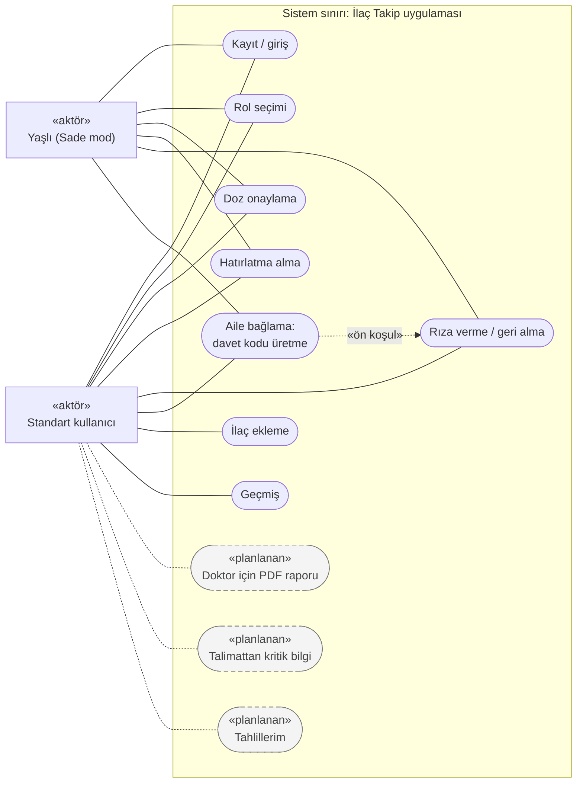

# 1a. Kullanım durumu diyagramı: Yaşlı ve Standart kullanıcı

Bu parça, ilacı kendi telefonunda kullanan iki aktörün kullanım durumlarını gösteriyor; aile tarafı 1b'de. Rollerin ayrımı üç rol kararından geliyor (ADR-015). Yaşlı (Sade mod) ilaç eklemiyor; yalnızca dozunu onaylıyor, hatırlatma alıyor, rızasını veriyor ve davet koduyla ailesini bağlıyor. İlacını ailesi Aile panelinden ekliyor. Standart kullanıcı ilacını kendisi ekliyor ve Geçmiş ekranını kullanıyor. Aileyle veri paylaşmanın ön koşulu sağlık verisi rızası (ADR-021); rızası olmayan kullanıcı davet kodu üretemiyor. Kesik çizgili ve «planlanan» etiketli öğeler yol haritasının 3–5. parçalarından. Mermaid'de kullanım durumu diyagramı olmadığından çizim flowchart ile yapıldı: aktörler dikdörtgen, kullanım durumları oval, sistem sınırı çerçeve.

Çıktı: [`cikti/01a-kullanim-durumu-yasli-standart.svg`](cikti/01a-kullanim-durumu-yasli-standart.svg), [`cikti/01a-kullanim-durumu-yasli-standart.png`](cikti/01a-kullanim-durumu-yasli-standart.png)

