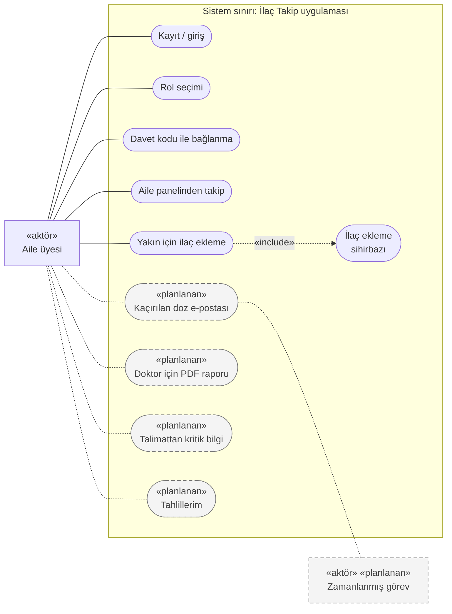

# 1b. Kullanım durumu diyagramı: Aile üyesi ve zamanlanmış görev

Bu parça, aile üyesinin ve planlanan sunucu görevinin kullanım durumlarını gösteriyor. Aile üyesi, yakınının ürettiği 6 haneli davet koduyla bağlanıyor (ADR-023). Ardından Aile panelinden yakınının bugünkü dozlarını, kaçırılan doz uyarısını ve ilacın telefona ulaşıp ulaşmadığını izliyor (ADR-025). Yakını için ilaç eklerken Standart kullanıcının sihirbazını kullanıyor («include»); başlıkta yalnızca "<yakın adı> için" yazıyor. Kaçırılan doz e-postası, PDF raporu, kritik bilgi ve Tahlillerim kesik çizgiyle gösterildi; 3–5. parçalarda gelecekler. Zamanlanmış görev bir insan değil: uygulama kapalıyken kaçırılan dozu sunucuda tespit edip aileye bildirecek planlanan bir aktör.

Çıktı: [`cikti/01b-kullanim-durumu-aile.svg`](cikti/01b-kullanim-durumu-aile.svg), [`cikti/01b-kullanim-durumu-aile.png`](cikti/01b-kullanim-durumu-aile.png)

