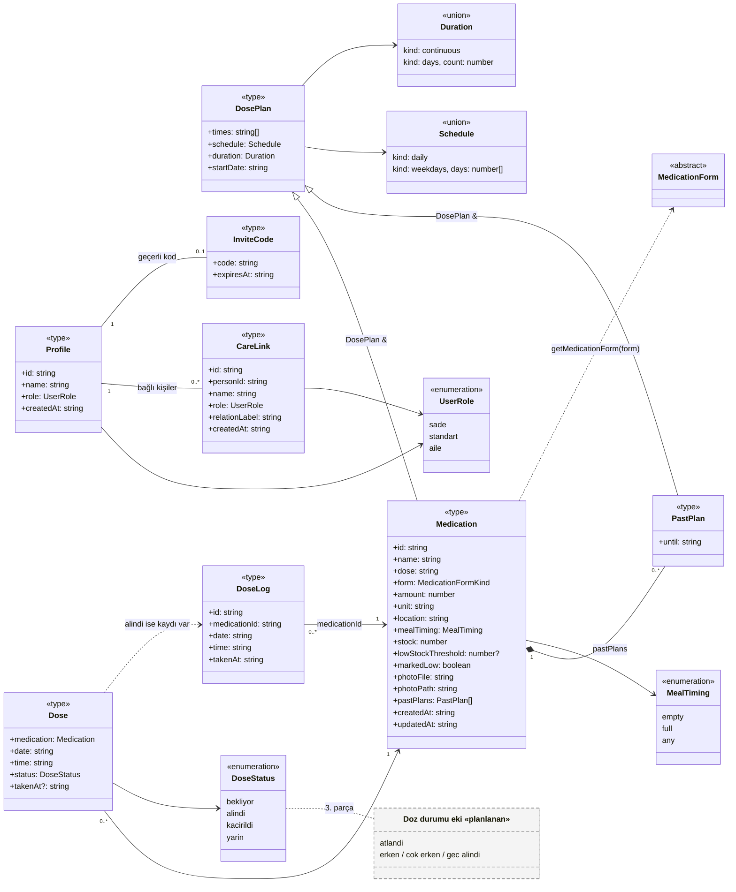

# 2a. Sınıf diyagramı: alan modeli

Diyagram, `src/models/` altındaki veri tiplerini ve aralarındaki ilişkileri gösteriyor. `Medication`, bir doz planını (`DosePlan`) genişletiyor. Plan değişince eski plan `pastPlans` içinde `PastPlan` olarak saklanıyor; böylece geçmiş günler değişmiyor (ADR-012). Veritabanına yalnızca alınan dozlar `DoseLog` olarak yazılıyor. `Dose` ve `DoseStatus` saklanmıyor, `DoseCalculator` saatten hesaplıyor. `doseLogIdOf` deterministik bir kimlik üretiyor; bu yüzden bir doz iki kez onaylanamıyor. İlacın türe göre değişen davranışı `MedicationForm` sınıf ailesinde; ayrıntısı 2b'de. Hesap tarafında `Profile`, `UserRole`, `CareLink` ve `InviteCode` var. Kesik çizgili kutular 3. parçada gelecek doz zamanlaması ve "Bu dozu atla" için planlanan durumlar; koddaki adları henüz belli değil.

Çıktı: [`cikti/02a-sinif-alan-modeli.svg`](cikti/02a-sinif-alan-modeli.svg), [`cikti/02a-sinif-alan-modeli.png`](cikti/02a-sinif-alan-modeli.png)

