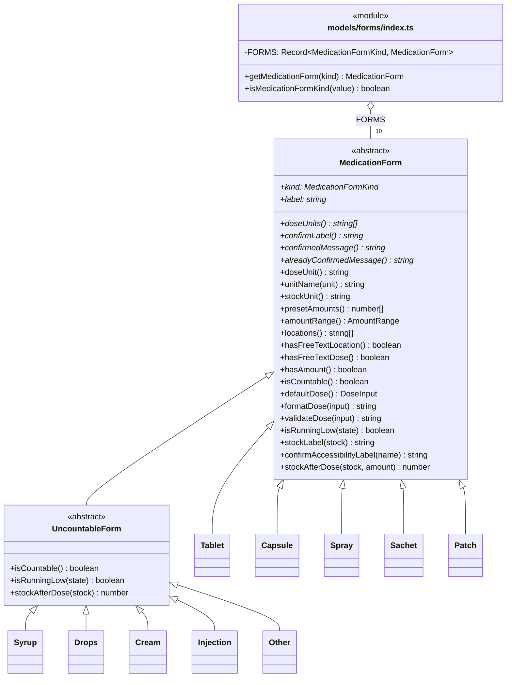

# 2b. Sınıf diyagramı: ilaç formları (kalıtım ve çok biçimlilik)

Diyagram, on ilaç formunun kalıtım ağacını gösteriyor (ADR-005, ADR-002). Bütün formlar soyut `MedicationForm` sınıfından türüyor ve dört soyut metodu uyguluyor: `doseUnits`, `confirmLabel`, `confirmedMessage`, `alreadyConfirmedMessage`. Sayılan formlar (`Tablet`, `Capsule`, `Spray`, `Sachet`, `Patch`) doğrudan bu sınıftan türüyor. Sayılamayan formlar (`Syrup`, `Drops`, `Cream`, `Injection`, `Other`) araya giren soyut `UncountableForm`'dan türüyor ve stok kuralını oradan alıyor; örneğin şurupta doz stoktan düşmüyor. Ekranlar ve `DoseService` formun türüne `if/switch` ile bakmıyor. `getMedicationForm(kind)` `FORMS` tablosundan doğru nesneyi veriyor; bilinmeyen tür `Tablet` sayılıyor. Böylece yeni bir form eklemek için yalnızca yeni bir sınıf yazmak ve tabloya bir satır eklemek yetiyor.

Çıktı: [`cikti/02b-sinif-ilac-formlari.svg`](cikti/02b-sinif-ilac-formlari.svg), [`cikti/02b-sinif-ilac-formlari.png`](cikti/02b-sinif-ilac-formlari.png)

