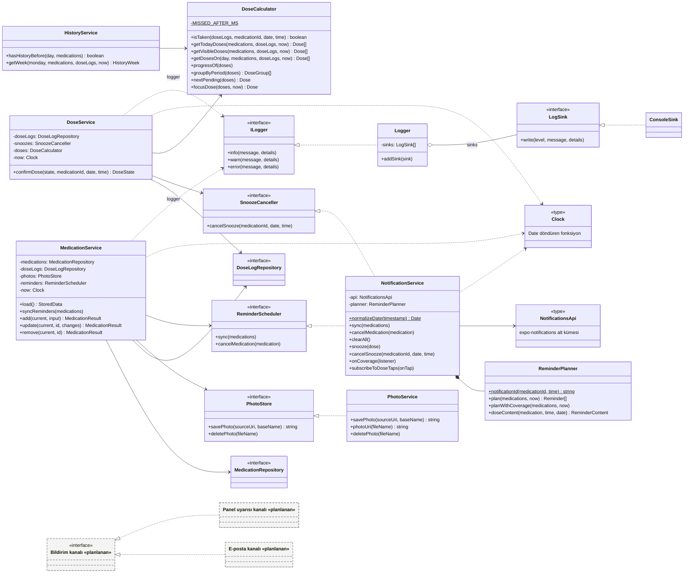

# 2c. Sınıf diyagramı: ilaç, doz ve bildirim servisleri

Diyagram, ilaç ve doz iş mantığını taşıyan servis sınıflarını ve bunların bağlı olduğu en küçük arayüzleri (port) gösteriyor. Servisler somut sınıfı tanımıyor, yalnızca arayüzü biliyor: `MedicationRepository`, `DoseLogRepository`, `ReminderScheduler`, `SnoozeCanceller`, `PhotoStore`, `ILogger`. Saat bile `Clock` olarak dışarıdan veriliyor. Bu tasarım bağımlılığın tersine çevrilmesi ve constructor ile enjeksiyon kararlarına dayanıyor (ADR-002, ADR-019). Testlerde aynı arayüzlere sahte nesneler veriliyor. `NotificationService` iki arayüzü birden uyguluyor; hangi hatırlatmanın kurulacağına saf `ReminderPlanner` karar veriyor (60 bildirim bütçesi, ADR-026). Ok türleri: içi boş üçgen ve kesik çizgi uygulama (realization), düz ok ilişki, kesik ok bağımlılık, dolu baklava sahiplik (composition). Kesik çizgili kutular 3. parçadaki bildirim kanalları (Strategy, ADR-029); kodda henüz yok, adları kesinleşmedi.

Çıktı: [`cikti/02c-sinif-ilac-doz-servisleri.svg`](cikti/02c-sinif-ilac-doz-servisleri.svg), [`cikti/02c-sinif-ilac-doz-servisleri.png`](cikti/02c-sinif-ilac-doz-servisleri.png)

