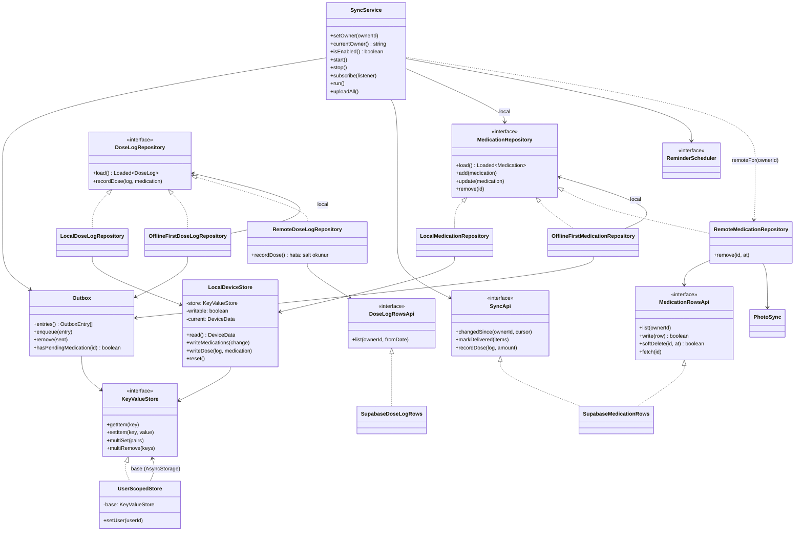

# 2d. Sınıf diyagramı: depolar (Repository) ve eşitleme

Diyagram, Repository deseninin üç uygulamasını ve eşitlemenin nasıl kurulduğunu gösteriyor (ADR-020, ADR-022). Servisler yalnızca `MedicationRepository` ve `DoseLogRepository` arayüzlerini biliyor. `Local…` sınıfları veriyi `LocalDeviceStore` üzerinden telefona yazıyor. `OfflineFirst…` sınıfları dekoratör gibi çalışıyor: önce yerel depoya yazıp, rıza varsa değişikliği `Outbox` kuyruğuna ekliyor. `Remote…` sınıfları Supabase satırlarına `MedicationRowsApi` ve `DoseLogRowsApi` portlarıyla erişiyor. `SyncService` kuyruğu sunucuya gönderiyor ve imleçten sonra değişen satırları alıyor (`SyncApi`). `UserScopedStore` her anahtarın önüne `u:<userId>:` ekliyor; böylece aynı telefondaki iki hesabın verisi karışmıyor (ADR-027). Supabase'e bağımlı sınıflar yalnızca `services/remote/` altında; bu sayede iş mantığı sunucu olmadan test edilebiliyor.

Çıktı: [`cikti/02d-sinif-depolar-esitleme.svg`](cikti/02d-sinif-depolar-esitleme.svg), [`cikti/02d-sinif-depolar-esitleme.png`](cikti/02d-sinif-depolar-esitleme.png)

