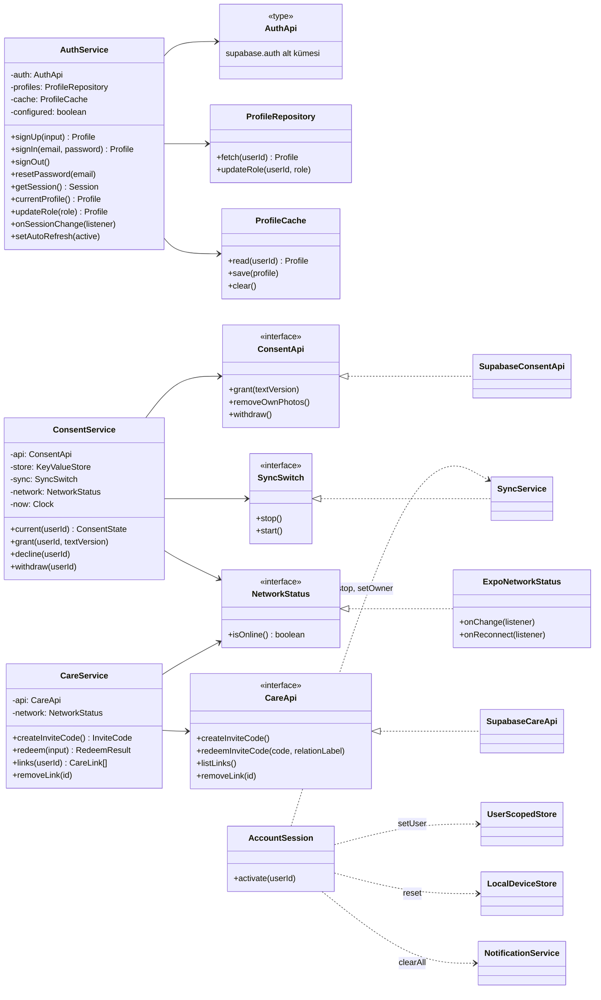

# 2e. Sınıf diyagramı: hesap, oturum, rıza ve eşleştirme

Diyagram, hesapla ilgili servisleri gösteriyor. `AuthService` Supabase Auth'u yalnızca `AuthApi` arayüzü üzerinden görüyor. Profili `ProfileRepository`'den okuyor ve `ProfileCache` ile telefonda saklıyor; böylece uygulama internetsiz de doğru ana ekranla açılıyor (ADR-018). `AccountSession`, hesap değişince eşitlemeyi durduruyor, önceki kullanıcının hatırlatmalarını kaldırıyor ve yerel depoyu yeni kullanıcıya geçiriyor (ADR-027). Bağımlılıklarını yapısal tiplerle (`setUser`, `reset`, `stop`, `clearAll`) alıyor. `ConsentService` rızayı sunucuya yazıyor ve geri alınınca eşitlemeyi kapatıyor (ADR-021). `CareService` davet kodunu üretiyor ve kodu kullanıyor (ADR-023). İnternet gerektiren işlemlerden önce `NetworkStatus` ile bağlantıyı denetliyor. Supabase bağımlılığı yalnızca `services/remote/` altındaki adaptörlerde.

Çıktı: [`cikti/02e-sinif-hesap-riza.svg`](cikti/02e-sinif-hesap-riza.svg), [`cikti/02e-sinif-hesap-riza.png`](cikti/02e-sinif-hesap-riza.png)

