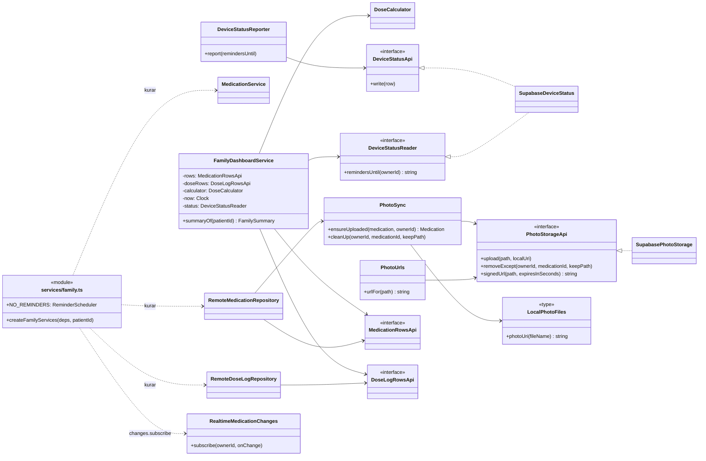

# 2f. Sınıf diyagramı: Aile paneli, fotoğraf ve telefon durumu

Diyagram, aile tarafının servislerini gösteriyor. `FamilyDashboardService` yakının ilaçlarını ve dozlarını sunucudan okuyor. Doz durumlarını telefondaki aynı `DoseCalculator` kurallarıyla hesaplıyor; böylece panel ile yaşlının telefonu aynı sonucu gösteriyor (ADR-025). Aile, yakını için ilacı `createFamilyServices` fabrika fonksiyonuyla kurulan aynı `MedicationService` ile ekliyor. Bu kurulumda depolar `Remote…` sınıfları, hatırlatma ise `NO_REMINDERS`; yani aile telefonu yakının hatırlatmalarını kurmuyor. Yaşlının telefonu hatırlatmaların ne zamana kadar kurulu olduğunu `DeviceStatusReporter` ile `device_status` tablosuna yazıyor (ADR-026). Fotoğrafı `PhotoSync` sıkıştırılmış hâliyle yüklüyor, `PhotoUrls` ise süreli imzalı adresi önbellekten veriyor (ADR-024). `SupabaseDeviceStatus` iki arayüzü birden uyguluyor: yazma yaşlının telefonunda, okuma aile panelinde kullanılıyor.

Çıktı: [`cikti/02f-sinif-aile-fotograf.svg`](cikti/02f-sinif-aile-fotograf.svg), [`cikti/02f-sinif-aile-fotograf.png`](cikti/02f-sinif-aile-fotograf.png)

