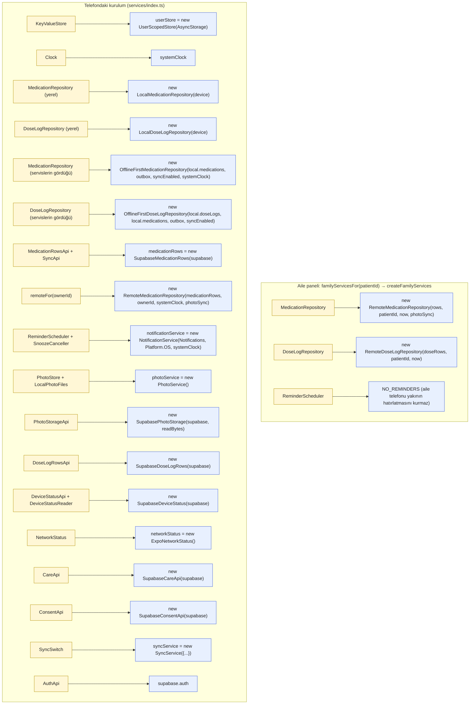

# 2g. Bileşim kökü (composition root): services/index.ts

Diyagram, `src/services/index.ts` dosyasında hangi somut sınıfın hangi arayüze bağlandığını gösteriyor. Soldaki sarı kutular arayüzler (port), sağdakiler `new` ile kurulan somut nesneler. Bağlantılar yalnızca bu dosyada kuruluyor (ADR-019, ADR-020). Ekranlar sınıflara değil, kancalar üzerinden buradaki hazır örneklere ulaşıyor. Testte aynı arayüzlere sahte nesneler verildiği için iş mantığı Supabase veya telefon olmadan sınanabiliyor. Örneğin servislerin gördüğü `MedicationRepository` aslında `OfflineFirstMedicationRepository`. O da içinde `LocalMedicationRepository`'yi ve `Outbox`'ı taşıyor; sunucu tarafı ise `SyncService` içinde `remoteFor` ile kurulan `RemoteMedicationRepository`. Alttaki bölüm, aile panelinde `familyServicesFor(patientId)` ile kurulan ikinci bağlantı kümesini gösteriyor. Orada aynı arayüzlere uzak depolar ve `NO_REMINDERS` bağlanıyor.

Çıktı: [`cikti/02g-composition-root.svg`](cikti/02g-composition-root.svg), [`cikti/02g-composition-root.png`](cikti/02g-composition-root.png)

