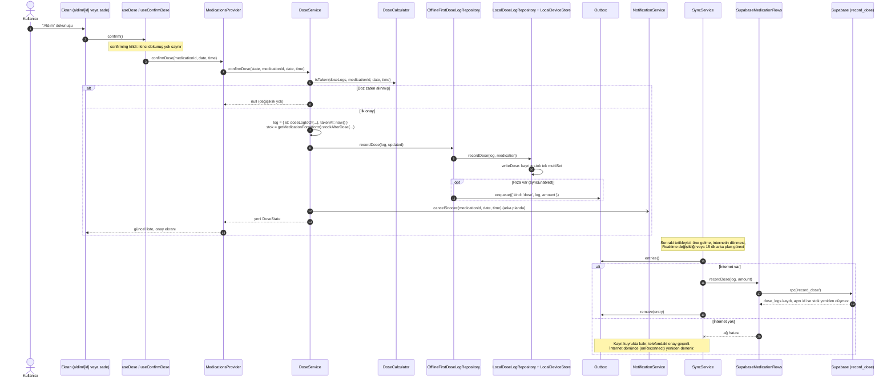

# 3a. Sıralama diyagramı: doz onayı (çevrimdışı önce)

Diyagram, kullanıcının "Aldım" dokunuşundan sunucudaki `record_dose` çağrısına kadar olan akışı gösteriyor. Tasarım "önce telefon" kararını yansıtıyor (ADR-022). Onay önce telefona yazılıyor: kayıt ve stok, `multiSet` ile tek seferde. Ekran hemen güncelleniyor; sunucuya gönderilecek iş `Outbox` kuyruğuna ekleniyor. Kuyruk, bir sonraki eşitleme tetikleyicisinde gönderiliyor. Bu tetikleyiciler: uygulamanın öne gelmesi, internetin dönmesi, Realtime değişikliği ve 15 dakikalık arka plan görevi. İnternet yoksa kayıt kuyrukta kalıyor ve telefondaki onay geçerliliğini koruyor. Doz kimliği `doseLogIdOf` ile deterministik üretildiğinden aynı doz iki kez gönderilse de sunucuda stok bir kez düşüyor. `useConfirmDose` içindeki kilit, art arda iki dokunuşu engelliyor. Rıza yoksa (`syncEnabled` false) kuyruğa hiçbir şey eklenmiyor ve veri yalnızca telefonda kalıyor (ADR-021).

Çıktı: [`cikti/03a-sira-doz-onayi.svg`](cikti/03a-sira-doz-onayi.svg), [`cikti/03a-sira-doz-onayi.png`](cikti/03a-sira-doz-onayi.png)

