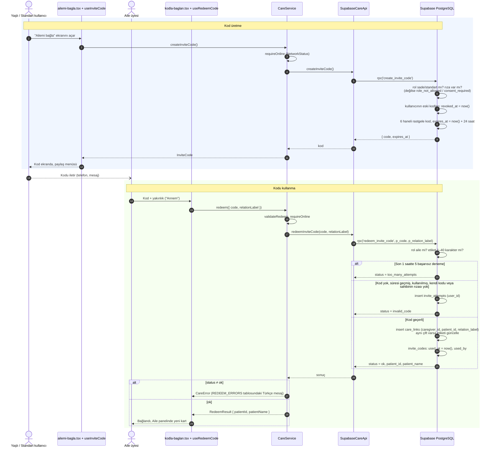

# 3b. Sıralama diyagramı: davet kodu ile eşleşme

Diyagram, yaşlının telefonunda kod üretilmesinden aile üyesinin bağlanmasına kadar olan akışı gösteriyor (ADR-023). Kod sunucuda `create_invite_code` ile üretiliyor. Yalnızca sade ve standart rol ile rıza vermiş kullanıcı kod üretebiliyor. Kod 6 haneli ve 24 saat geçerli; yeni kod üretilince eskisi iptal ediliyor (`revoked_at`). Aile üyesi kodu `redeem_invite_code` ile kullanıyor. Fonksiyon sırayla rolü, yakınlık etiketini ve deneme sınırını denetliyor. Son bir saatte 5 başarısız deneme varsa doğru kod da kabul edilmiyor; böylece sınır, kodun doğru olup olmadığını sızdırmıyor. Yalnızca başarısız denemeler `invite_attempts` tablosuna yazılıyor. Bütün denetimler sunucuda `security definer` fonksiyonlarda yapılıyor; uygulamada `CareService` yalnızca biçimi doğruluyor ve internet olup olmadığına bakıyor.

Çıktı: [`cikti/03b-sira-davet-kodu.svg`](cikti/03b-sira-davet-kodu.svg), [`cikti/03b-sira-davet-kodu.png`](cikti/03b-sira-davet-kodu.png)

