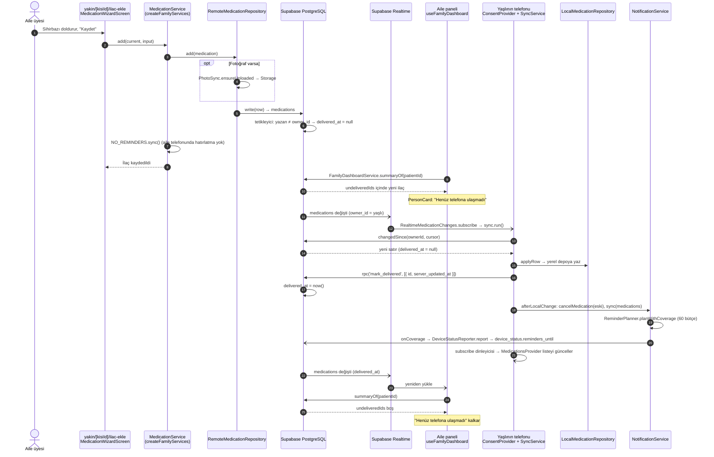

# 3c. Sıralama diyagramı: aile ilaç ekliyor, yaşlının telefonuna ulaşıyor

Diyagram, aile üyesinin yakını için eklediği ilacın sunucu ve Realtime üzerinden yaşlının telefonuna ulaşmasını ve panelin bunu görmesini gösteriyor (ADR-022, ADR-025). Aile tarafında aynı `MedicationService` kullanılıyor, yalnızca depo uzak (`RemoteMedicationRepository`) ve hatırlatıcı `NO_REMINDERS`. Satırı başkası yazdığı için sunucudaki tetikleyici `delivered_at` alanını boş bırakıyor. Panel bu yüzden "Henüz telefona ulaşmadı" gösteriyor. Yaşlının telefonu Realtime bildirimiyle eşitleme yapıyor. Satırı yerel depoya uyguluyor ve `mark_delivered` ile teslim aldığını yazıyor. Ardından ilacın hatırlatmalarını kuruyor. Koddaki sıra da böyle: `pull` içinde önce teslim işaretleniyor, `afterLocalChange` içinde sonra hatırlatma kuruluyor. Hatırlatma kurulamazsa ilaç yine de telefonda; `reminders_until` ve panel uyarısı bu durumu ayrıca gösteriyor. Panel, aynı tablodaki değişikliği Realtime ile alıp yeniden yükleniyor ve uyarı kalkıyor.

Çıktı: [`cikti/03c-sira-aile-ilac-ekleme.svg`](cikti/03c-sira-aile-ilac-ekleme.svg), [`cikti/03c-sira-aile-ilac-ekleme.png`](cikti/03c-sira-aile-ilac-ekleme.png)

