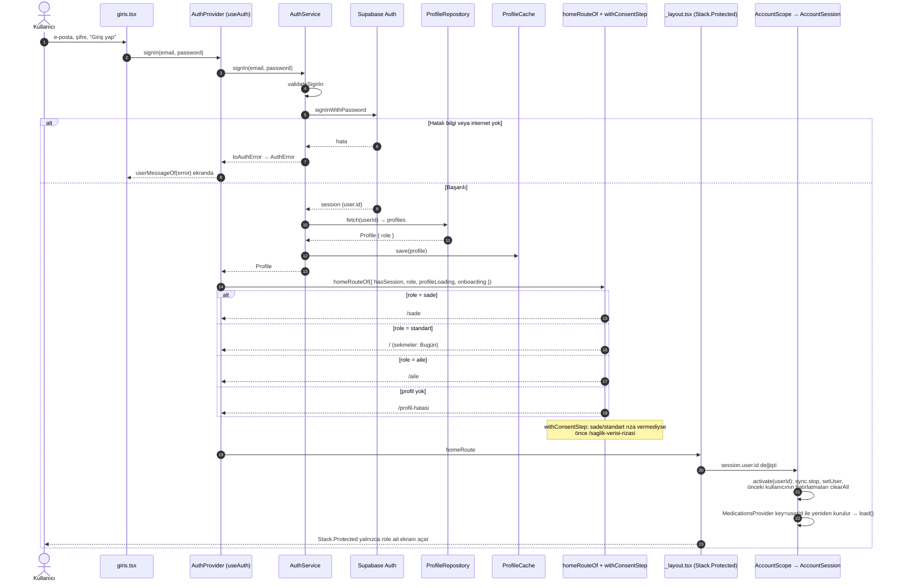

# 3d. Sıralama diyagramı: giriş ve role göre yönlendirme

Diyagram, giriş yapan kullanıcının rolüne göre doğru ana ekrana nasıl yönlendirildiğini gösteriyor (ADR-018). `AuthService.signIn` Supabase Auth ile oturum açıyor, `profiles` tablosundan rolü okuyor ve profili `ProfileCache` ile telefonda saklıyor. Supabase hataları `toAuthError` tablosuyla Türkçe `AuthError`'a çevriliyor. Hangi ekranın açılacağına saf `homeRouteOf` fonksiyonu karar veriyor; `withConsentStep` gerekiyorsa önce rıza ekranını ekliyor. Kök yerleşim (`_layout.tsx`) ekranları `Stack.Protected` ile koruyor; kullanıcı yalnızca rolüne ait ekrana girebiliyor. Hesap değişince `AccountScope`, `AccountSession.activate` ile yerel depoyu yeni kullanıcıya geçiriyor (ADR-027). Ardından `MedicationsProvider`'ı `key=userId` ile yeniden kuruyor; böylece önceki kullanıcının verisi ekranda kalmıyor.

Çıktı: [`cikti/03d-sira-giris-yonlendirme.svg`](cikti/03d-sira-giris-yonlendirme.svg), [`cikti/03d-sira-giris-yonlendirme.png`](cikti/03d-sira-giris-yonlendirme.png)

