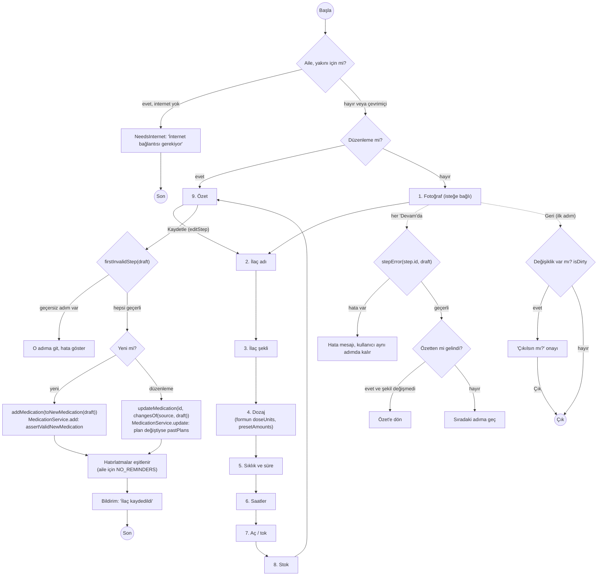

# 4a. Etkinlik diyagramı: ilaç ekleme sihirbazı

Diyagram, dokuz adımlı ilaç ekleme sihirbazının akışını gösteriyor (ADR-004). Adımlar `validation/wizard-steps.ts` içindeki `WIZARD_STEPS` sırasında: Fotoğraf, İlaç adı, İlaç şekli, Dozaj, Sıklık ve süre, Saatler, Aç/tok, Stok, Özet. "Devam" her adımda yalnızca o adımın alanlarını `stepError` ile denetliyor; hata varsa kullanıcı aynı adımda kalıyor ve Türkçe mesajı görüyor. Düzenleme Özet adımından başlıyor. Özetten bir adım düzenlenince "Devam" yeniden Özet'e dönüyor; yalnızca ilaç şekli değiştiyse, dozun yeni birimle girilmesi için sıradaki adıma (Dozaj) geçiliyor. "Kaydet", bütün taslağı `firstInvalidStep` ile bir kez daha denetliyor. Ardından ya yeni ilacı ekliyor ya da yalnızca değişen alanları (`changesOf`) kaydediyor. Doğrulama ekranda ve serviste aynı zod şemalarıyla yapılıyor (ADR-020). Aile çevrimdışıyken sihirbaz açılmıyor.

Çıktı: [`cikti/04a-etkinlik-sihirbaz.svg`](cikti/04a-etkinlik-sihirbaz.svg), [`cikti/04a-etkinlik-sihirbaz.png`](cikti/04a-etkinlik-sihirbaz.png)

