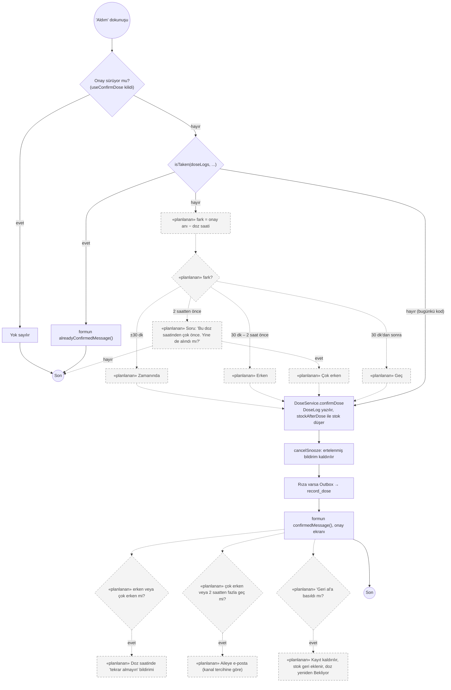

# 4b. Etkinlik diyagramı: doz onay kararı

Diyagram, kullanıcı "Aldım"a bastığında verilen kararları gösteriyor. Düz çizgili kısım bugün kodda olan akış. Doz daha önce onaylanmışsa (`isTaken`) yeni kayıt yazılmıyor. Onaylanmamışsa `DoseLog` yazılıyor, stok formun kuralıyla düşüyor ve ertelenmiş bildirim kaldırılıyor. Kesik çizgili ve «planlanan» etiketli kısım 3. parçanın doz zamanlaması tasarımı. Onay anı doz saatiyle karşılaştırılacak: ±30 dakika zamanında, 30 dakika–2 saat önce erken, 2 saatten önce çok erken, 30 dakikadan sonra geç. Çok erken onayda kullanıcıya soru sorulacak. Erken alınan dozun saatinde "tekrar almayın" bildirimi gelecek; onay "Geri al" ile kaldırılabilecek. Çok erken ve 2 saatten fazla geç dozlar aileye e-postayla bildirilecek. Bu sınıflandırma tıbbi yorum değil; kullanıcının girdiği saatle onay anının karşılaştırılması (ADR-028).

Çıktı: [`cikti/04b-etkinlik-doz-onay-karari.svg`](cikti/04b-etkinlik-doz-onay-karari.svg), [`cikti/04b-etkinlik-doz-onay-karari.png`](cikti/04b-etkinlik-doz-onay-karari.png)

