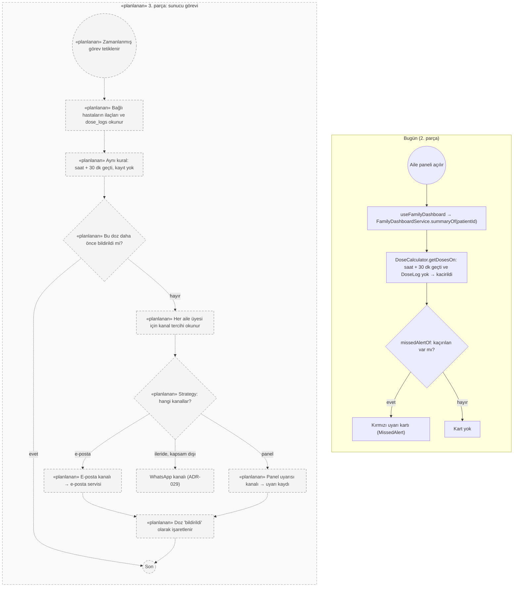

# 4c. Etkinlik diyagramı: kaçırılan doz tespiti

Diyagram, kaçırılan dozun bugün nasıl tespit edildiğini ve 3. parçada nasıl tespit edileceğini gösteriyor. Düz çizgili sol kol bugünkü davranış. Aile paneli açıldığında `FamilyDashboardService.summaryOf` dozları `DoseCalculator` kurallarıyla hesaplıyor; saati 30 dakika geçmiş ve onaylanmamış doz kaçırılmış sayılıyor. `missedAlertOf` sonucunda kırmızı uyarı kartı gösteriliyor (ADR-025). Kesik çizgili sağ kol planlanan sunucu görevi. Uygulama kapalıyken de zamanlanmış görev bağlı hastaların kaçırılan dozlarını aynı kuralla bulacak. Bir doz için bir kez bildirim gönderilecek. Her aile üyesinin seçtiği kanallar Strategy deseniyle çalıştırılacak: e-posta kanalı ve panel uyarısı kanalı. WhatsApp bu yapıya ileride tek bir kanal sınıfı olarak eklenebilir; şimdilik kapsam dışı (ADR-029). Planlanan öğelerin koddaki adları henüz belli değil.

Çıktı: [`cikti/04c-etkinlik-kacirilan-doz.svg`](cikti/04c-etkinlik-kacirilan-doz.svg), [`cikti/04c-etkinlik-kacirilan-doz.png`](cikti/04c-etkinlik-kacirilan-doz.png)

