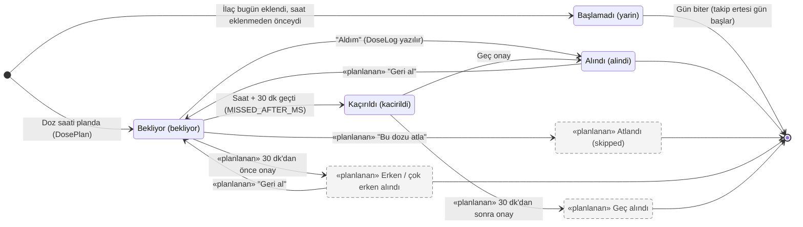

# 5. Durum diyagramı: bir dozun durumları

Diyagram, bir dozun `DoseStatus` değerleri arasındaki geçişleri gösteriyor. Durumlar saklanmıyor, her seferinde hesaplanıyor (ADR-012). Telefonda yalnızca alınan doz `DoseLog` olarak var. `DoseCalculator.statusOf` kayıt varsa `alindi`, saat 30 dakikadan fazla geçtiyse `kacirildi`, aksi hâlde `bekliyor` döndürüyor. İlacın eklendiği gün, eklenmeden önceki saatler kaçırılmış sayılmıyor; `yarin` olarak işaretleniyor ve ilerlemeye katılmıyor. Kaçırılan doz sonradan onaylanabiliyor. Kesik çizgili ve «planlanan» durumlar 3. parçada gelecek. "Bu dozu atla" seçeneği `Atlandı` durumunu getirecek; sunucudaki `dose_logs.status` sütunu `skipped` değerini şimdiden kabul ediyor. Doz zamanlaması ise `Erken alındı` ve `Geç alındı` durumlarını ayıracak. "Geri al" dozu yeniden `Bekliyor` (ya da süresi geçmişse `Kaçırıldı`) durumuna döndürecek.

Çıktı: [`cikti/05-durum-doz.svg`](cikti/05-durum-doz.svg), [`cikti/05-durum-doz.png`](cikti/05-durum-doz.png)

