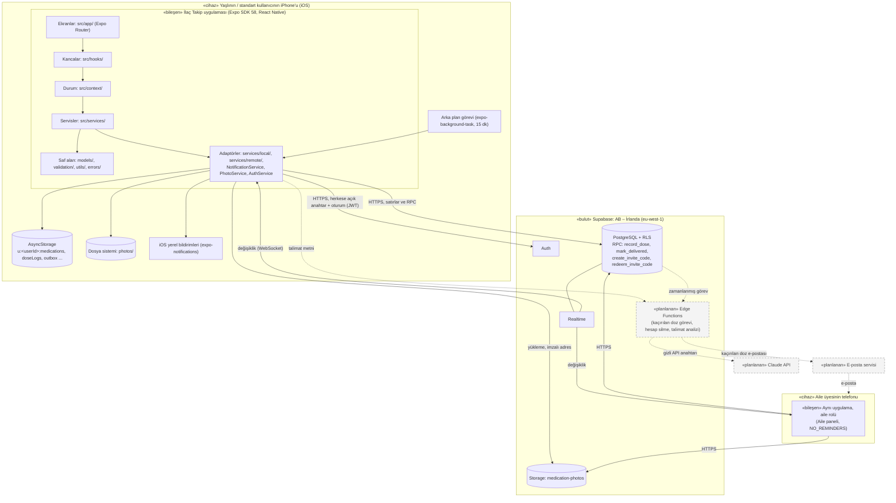

# 6. Bileşen ve dağıtım diyagramı

Diyagram, uygulamanın katmanlarını ve hangi bileşenin nerede çalıştığını gösteriyor. Telefondaki uygulamada katmanlar yukarıdan aşağıya: ekranlar, kancalar, durum, servisler ve saf alan (model, doğrulama, utils). Ekranlar servislere yalnızca kancalar üzerinden ulaşıyor; bu kuralı `dependency-cruiser` denetliyor (ADR-020). Platforma ve sunucuya bağlı kod yalnızca adaptörlerde. Veri önce telefonda AsyncStorage'a hesaba özel anahtarlarla yazılıyor (ADR-027), bildirimler telefonun kendi yerel bildirimleriyle kuruluyor (ADR-001). Supabase, AB – İrlanda (eu-west-1) bölgesinde (ADR-016): Auth, satır güvenlikli (RLS) PostgreSQL, fotoğraf deposu ve Realtime. Uygulama yalnızca herkese açık anahtarı biliyor; erişimi RLS sınırlıyor. Kesik çizgili bileşenler planlanan: Edge Functions, Claude API ve e-posta servisi. Claude API anahtarı uygulamaya hiç girmeyecek, yalnızca Edge Function'da sunucu sırrı olarak duracak.

Çıktı: [`cikti/06-bilesen-dagitim.svg`](cikti/06-bilesen-dagitim.svg), [`cikti/06-bilesen-dagitim.png`](cikti/06-bilesen-dagitim.png)

