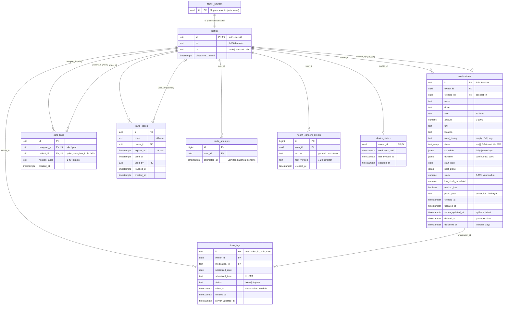

# 7. ER diyagramı: Supabase veritabanı

Diyagram, `supabase/migrations/` altındaki migration'lardan çıkarılan veritabanı şemasını gösteriyor. Rapordaki 8. bölümde de kullanılacak. Her kullanıcının `auth.users` ile bire bir eşleşen bir `profiles` satırı var; rolü (`rol`: sade, standart, aile) burada tutuluyor. `medications` ve `dose_logs` ilacın sahibine (`owner_id`) bağlı. `dose_logs.id`, ilaç kimliği + tarih + saat olarak denetleniyor (`dose_logs_id_matches`); bu yüzden aynı doz iki kez yazılamıyor. `medications.delivered_at` "telefona ulaştı" bilgisini, `deleted_at` yumuşak silmeyi, `server_updated_at` eşitleme imlecini taşıyor. Aile bağlantısı `care_links` tablosunda iki profil arasında kuruluyor: `caregiver_id` aile üyesi, `patient_id` yakın; aynı çift bir kez bulunabiliyor. `invite_codes` ve `invite_attempts` eşleştirmeyi ve deneme sınırını (ADR-023), `health_consent_events` rıza geçmişini (ADR-021), `device_status` ise `reminders_until` bilgisini (ADR-026) tutuyor. Bütün tablolarda RLS açık. Silme `on delete cascade` ile profilden aşağı iniyor; `created_by` ve `used_by` ise `set null` oluyor. Fotoğraflar Storage'daki `medication-photos` kovasında; `photo_path`, sahibin kimliğiyle başlamak zorunda.

Çıktı: [`cikti/07-er-veritabani.svg`](cikti/07-er-veritabani.svg), [`cikti/07-er-veritabani.png`](cikti/07-er-veritabani.png)

